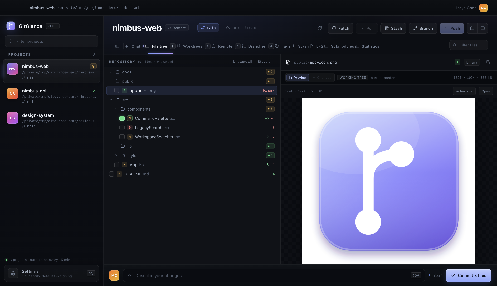
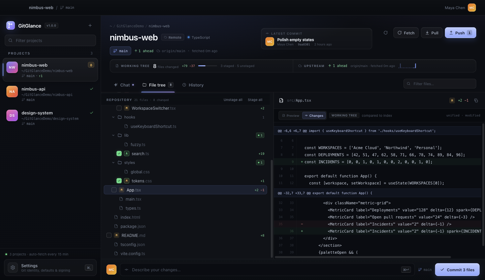
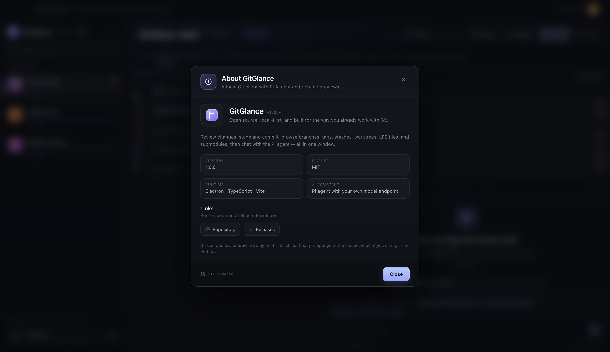

# GitGlance

[English](./README.en.md) | **简体中文**

一款围绕 [index.html](./index.html) 中的界面构建的本地 Git 桌面客户端。它运行在 Electron 中，调用本机已安装的 Git CLI，通过 Pi coding agent 提供 AI 对话，并可在不上传任何内容的前提下预览图片、PDF、Word/Excel/PowerPoint 文档和文本文件。

**官方链接**

- 仓库：[github.com/delong8/git-glance](https://github.com/delong8/git-glance)
- 发布下载：[github.com/delong8/git-glance/releases](https://github.com/delong8/git-glance/releases)


## 文档

[使用指南](./docs/USAGE.zh.md)是面向最终用户的完整教程（另有[英文版](./docs/USAGE.md)）：打开与切换仓库、阅读摘要、浏览工作区、预览文件、暂存与提交、对话页的提交历史图及其提交操作、工作树、远程、分支、标签、贮藏、LFS 审计、子模块、仓库统计与 HTML 报告、与远程同步、AI 对话、设置、关于对话框以及故障排查。

快速链接：

- [快速开始](./docs/USAGE.zh.md#快速开始)
- [打开仓库](./docs/USAGE.zh.md#打开仓库)
- [浏览文件与更改](./docs/USAGE.zh.md#浏览文件与更改)
- [预览文件](./docs/USAGE.zh.md#预览文件)
- [提交更改](./docs/USAGE.zh.md#提交更改)
- [工作树](./docs/USAGE.zh.md#工作树)
- [远程](./docs/USAGE.zh.md#远程)
- [分支](./docs/USAGE.zh.md#分支)
- [标签](./docs/USAGE.zh.md#标签)
- [贮藏](./docs/USAGE.zh.md#贮藏)
- [LFS](./docs/USAGE.zh.md#lfs)
- [子模块](./docs/USAGE.zh.md#子模块)
- [统计](./docs/USAGE.zh.md#统计)
- [与 Pi 进行 AI 对话](./docs/USAGE.zh.md#与-pi-进行-ai-对话)
- [对话内的提交操作](./docs/USAGE.zh.md#对话内的提交操作)
- [设置](./docs/USAGE.zh.md#设置)
- [关于 GitGlance](./docs/USAGE.zh.md#关于-gitglance)
- [键盘快捷键](./docs/USAGE.zh.md#键盘快捷键)
- [故障排查](./docs/USAGE.zh.md#故障排查)

### 截图

| 文件树与预览 | 图片预览 |
| --- | --- |
|  |  |

| 工作区差异 | 设置 |
| --- | --- |
|  |  |

| 提示词设置 | 关于 GitGlance |
| --- | --- |
|  |  |

## 功能

- **多仓库侧边栏**：支持筛选、显示每个项目的分支与更改数量，未打开仓库时显示引导界面。仓库标题左侧的面板按钮可将其收起。
- **仓库摘要**：显示当前分支、领先/落后数量，以及获取、拉取、贮藏、分支、推送操作。贮藏可一键保存工作区；分支会打开选择器，可从任意本地或远程分支切换或创建分支。最右侧的紧凑按钮组可在系统文件管理器中打开仓库文件夹，或在该路径启动终端。
- **完整的工作区文件树**：包含文件夹、符号链接、已暂存/未暂存/已删除标记、单文件暂存开关以及筛选。
- **预览与差异面板**：位于 文件树 和 对话 标签页。选择文件即可预览；也可切换到其已暂存或未暂存差异。
- **丰富的预览**
  - 图片：PNG、JPEG、GIF、WebP、AVIF、BMP、ICO、SVG。
  - PDF：使用 PDF.js 渲染，支持翻页与缩放。
  - Word、Excel、PowerPoint 与 OpenDocument 文件：先由 LibreOffice 转换为 PDF，再由 PDF.js 渲染。
  - 文本与源代码文件：编码检测（UTF-8/UTF-16 及传统编码）、语法高亮、行号，超大文件会被截断。
  - 已删除文件：从 HEAD 版本预览。
  - 二进制文件：给出清晰提示，而不是乱码内容。
- **工作树标签页**：列出该仓库的所有关联工作树，包含分支、HEAD、路径、主/当前/已锁定/可清理标记、筛选，以及打开/在文件夹中显示/复制操作。
- **远程标签页**：列出每个已配置远程的获取与推送 URL、默认分支、远程跟踪分支、筛选，支持按远程获取，以及复制/打开操作。
- **分支标签页**：列出本地与远程跟踪分支，包含当前/远程/已消失标记、上游与领先/落后状态、最新提交详情、筛选，以及检出/复制操作；摘要栏还提供分支选择器，可从任意分支切换或创建分支。
- **标签页（Tags）**：列出轻量标签与附注标签，包含类型/HEAD 标记、附注、打标签者、目标提交详情、筛选，以及检出/复制操作。
- **贮藏标签页**：列出贮藏的工作，包含分支、说明、基础提交、文件统计、筛选，以及应用/弹出/删除/复制操作；摘要栏的 贮藏 按钮会保存已跟踪和未跟踪的更改。
- **LFS 标签页**：双栏审计——左侧为 LFS 跟踪的文件，右侧为大于 5 MB 的非 LFS 文件，包含大小、OID、指针/跟踪标记、筛选，以及打开/在文件夹中显示/复制操作。
- **子模块标签页**：列出每个子模块的 URL、期望/已检出的提交、分支、初始化/已修改/脏状态、筛选，以及更新/打开/在文件夹中显示/复制操作。
- **统计标签页**：展示提交、贡献者、文件、语言、活动、仓库与工作区指标，并提供 **下载** 操作，生成自包含的 HTML 报告。
- **AI 对话标签页**：由 Pi agent 驱动，三栏工作区——左侧是覆盖全部引用的提交历史图，先加载最新 80 个提交，滚动时再分页加载更早的提交；中间是对话上方的已更改文件树；右侧是预览面板，选中已更改文件时打开。预览带有隐藏按钮，文件树与对话可占满整宽。右键单击提交可新建分支、新建标签、拣选（cherry-pick）、还原（revert）、重置（软/混合/硬）、压缩合并到父提交，以及复制 SHA。此外还支持流式回复、工具活动（包括 Git 与 shell 命令）、停止/新建对话控件、光标位于输入框末尾时用 ↑/↓ 召回已发送消息，以及按仓库隔离的对话历史。
- **Git 设置**：身份、默认分支、编辑器、拉取策略、GPG 签名、清理，以及应用级自动获取行为。
- **提示词**：为 Pi agent 追加一段系统提示词（叠加在 GitGlance 内置的助手说明之后），并最多添加八条自定义用户提示词，每条含简短标题（显示在芯片上）与完整发送文本，以一键芯片的形式显示在对话输入框上方。
- **关于对话框**：由侧边栏品牌文字旁的信息按钮打开，显示发布标签（与安装包文件名相同的 `YYMMDD.shortSHA` 标记）、MIT 许可证、运行时技术栈、Pi 助手说明，以及仓库/发布链接。
- **外观**：支持浅色、深色和跟随系统三种主题，以及界面缩放（50%–300%），即时生效并在下次启动时保留。
- **语言**：支持英文、简体中文或跟随系统语言，即时应用于界面与原生菜单；仓库内容、代码与提交信息保持原样。
- **原生桌面外壳**：自定义协议、沙盒渲染进程、上下文隔离的 IPC、原生菜单，以及单实例行为。

## 环境要求

- **Node.js 22+** 与 npm（已在 Node 26 上测试），用于从源码运行或构建安装包。打包后的应用不需要 Node.js。
- **macOS**，用于在本地构建 `.app`/DMG；Windows x64 安装包可按下文说明交叉构建。
- **Git** 已安装并配置好凭据。GitGlance 使用 `PATH` 中的 `git`，不捆绑 Git。
- **Pi agent CLI**（`pi`）在 `PATH` 中可用，或将 `PI_BIN` 指向其可执行文件。在 **设置 → LLM 提供商** 中配置模型端点；GitGlance 以 `--mode rpc` 启动 Pi，并启用 `read`、`grep`、`find`、`ls` 与 `bash` 工具。
- **LibreOffice** 为可选项。仅当需要 Word/Excel/PowerPoint 预览时才需安装。GitGlance 会在常见位置查找 `soffice`，或使用 `LIBREOFFICE_BIN`。

应用源码为严格模式的 TypeScript：渲染进程由 Vite 编译，Electron 主进程/预加载/服务由 `tsc` 编译到 `dist-electron/`。构建与测试脚本仍为 `.mjs` 工具脚本。

已在 macOS 上测试。Electron 主进程是跨平台的，Windows x64 安装包也能成功构建，但本工作区尚未在 Windows 上验证运行时行为。

## 运行

```bash
npm install
npm start
```

`npm start` 会先构建 TypeScript 渲染进程与 Electron 进程，然后启动 Electron。首次启动时使用 **打开仓库…**（或 <kbd>⌘O</kbd>）添加一个 Git 工作区。仓库会在下次启动时保留。

渲染进程热重载：

```bash
npm run dev
```

它会在 `127.0.0.1:5173` 启动 Vite，并让 Electron 指向它。

从命令行直接打开仓库：

```bash
npx electron . --repo /path/to/repository
```

若某个工具不在标准位置，启动前设置 `PI_BIN` 或 `LIBREOFFICE_BIN`：

```bash
PI_BIN=/opt/homebrew/bin/pi LIBREOFFICE_BIN=/Applications/LibreOffice.app/Contents/MacOS/soffice npm start
```

## 构建 macOS 安装包

macOS 安装包由 electron-builder 构建到 `release/`：

```bash
npm run pack:mac           # release/mac-arm64/GitGlance.app
npm run dist:mac           # Apple Silicon DMG，若有 Developer ID 则签名
npm run dist:mac:unsigned  # 强制本地构建，不使用 Developer ID（ad-hoc 签名）
```

DMG 输出路径：

```text
release/GitGlance-[YYMMDD.COMMIT_SHORT_SHA]-arm.dmg
```

例如：`release/GitGlance-261124.a1b2c3d-arm.dmg`。日期是本地构建日期（`YYMMDD`），后缀为 `git rev-parse --short=7 HEAD`。应用会在侧边栏徽标和关于对话框中显示同一标签，因此截图或问题报告可精确定位到具体构建。

打开后将 **GitGlance** 拖入「应用程序」。若没有 Developer ID 证书，构建由 `scripts/after-pack.mjs` 做 ad-hoc 签名；本地构建的产物不会被 macOS 隔离，因此在构建机上可正常打开。复制到另一台 Mac 后会被下载隔离，Gatekeeper 在清除隔离标记前会拒绝启动：

```bash
xattr -dr com.apple.quarantine /Applications/GitGlance.app
```

清除标记只是本地测试的变通做法——若要分发，请使用 Developer ID 签名并公证（见下文）。

默认安装包面向 Apple Silicon（`arm64`）。如需构建通用 DMG：

```bash
npm run build
npx electron-builder --mac --universal
```

### 签名与公证

若要在自己的 Mac 之外分发，请使用 Apple Developer ID Application 证书。electron-builder 会自动发现已安装的证书，也可通过 `CSC_LINK`/`CSC_NAME` 指定。证书就绪后构建并公证：

```bash
export APPLE_ID="you@example.com"
export APPLE_APP_SPECIFIC_PASSWORD="abcd-efgh-ijkl-mnop"
export APPLE_TEAM_ID="ABCDE12345"

npm run build
npx electron-builder --mac --arm64 --config.mac.notarize=true
```

`@electron/notarize` 也接受 App Store Connect API 密钥，通过 `APPLE_API_KEY`、`APPLE_API_KEY_ID` 和 `APPLE_API_ISSUER` 传入。签名所用的强化运行时权限配置位于 `build/entitlements.mac.plist`。

打包后的应用不捆绑 Git、Pi 或 LibreOffice。它会在 `PATH` 中查找 Git，在标准 Homebrew/用户主目录位置查找 Pi，并在 `/Applications` 或 Homebrew 中查找 LibreOffice。从终端启动时 `PI_BIN` 与 `LIBREOFFICE_BIN` 有效；若通过 Finder 启动，应将自定义工具路径软链到 `/opt/homebrew/bin` 或 `/usr/local/bin` 等标准位置。

## 构建 Windows 安装包

electron-builder 可在 macOS 上交叉构建 Windows x64 NSIS 安装包：

```bash
npm run dist:win
npm run dist:all   # macOS arm64 DMG + Windows x64 安装包
```

交付物为单个安装包：

```text
release/GitGlance-[YYMMDD.COMMIT_SHORT_SHA]-x64.exe
```

例如：`release/GitGlance-261124.a1b2c3d-x64.exe`。`dist:win` 与 `dist:all` 会按该约定重命名新构建的安装包，删除所构建平台上的旧安装包，并清理 electron-builder 的中间产物（`win-unpacked`、blockmap、更新元数据），因此 `release/` 中只保留当前安装包。它未签名，Windows SmartScreen 可能在首次启动时告警；分发前请使用 Windows 代码签名证书签名。安装包使用 `build/icon.ico` 中的 GitGlance 图标，提供带可选安装目录的向导式按用户安装。

在 Apple Silicon 上，electron-builder 自带的 `makensis` 仅支持 Intel。请安装 Rosetta 2（`softwareupdate --install-rosetta --agree-to-license`），或将 `ELECTRON_BUILDER_NSIS_DIR` 指向一个原生 arm64 NSIS 包（包含 `elevate.exe` 与 `mac/makensis`）。在 Windows 或 Windows CI runner 上构建可完全避免交叉构建需求。Windows 包由同一套渲染进程与 Electron 主进程构建，但本工作区尚未在 Windows 上实际运行过。

## AI 对话

对话标签页为每个仓库保留一个 Pi RPC 进程。每次提示包含：

- 仓库路径与当前分支；
- 上游及领先/落后状态；
- 已更改文件及其状态与行数；
- 最近八条提交；
- 已暂存与未暂存的差异（各截断到约 22 KB）；
- 已更改文件树中选中的文件（若有）。

对话左栏展示覆盖本地、远程跟踪与标签引用的提交图。右键单击提交可创建分支或标签、拣选、还原、重置、将其压缩合并到父提交，或复制其 SHA。

Pi 以 `read`、`grep`、`find`、`ls` 与 `bash` 工具启动。它可以按你的要求执行 Git 及其他 shell 命令，包括创建提交；系统提示词要求它说明影响，并在执行破坏性操作前征求确认。shell 命令以与 GitGlance 相同的系统权限运行，因此请审阅 agent 提议的操作，并将仓库内容视为不受信任的输入。对话状态按仓库保存在渲染进程中，**新建对话** 会重置底层的 Pi 会话，**停止** 会中止当前回复。

GitGlance 自行配置模型。**设置 → LLM 提供商** 会在应用配置中保存提供商 ID、API 协议（`openai-completions`、`openai-responses`、`anthropic-messages`、`google-generative-ai` 或 `google-vertex`）、基础 URL、API 密钥与模型 ID。启动 Pi 之前，GitGlance 会把这些值写入自有的 `pi-agent` 目录（`models.json` 与 `settings.json`），并以 `PI_CODING_AGENT_DIR` 指向该目录来启动 Pi。生成的设置还会将 `defaultProjectTrust` 设为 `never`，因此既不会读取用户级 `~/.pi`，也不会读取仓库内的 `.pi` 目录。提示词与文件片段可能会被发送到所配置的模型端点；Git 操作与预览始终在本地完成。

## Git 行为

GitGlance 在仓库工作目录中直接运行 `git`，并设置 `LC_ALL=C` 与 `GIT_TERMINAL_PROMPT=0`：

- 暂存与取消暂存单个文件，暂存/取消暂存全部文件；
- 提交已暂存的更改；
- 贮藏已跟踪与未跟踪的更改；
- 切换分支，并从任意本地或远程分支创建本地分支；
- 在任意提交上创建分支和轻量标签，以及从对话历史菜单拣选、还原、重置（软/混合/硬）并将提交压缩合并到父提交；
- 获取（可选全部远程并清理）、拉取（merge/rebase/ff-only）与推送；
- 读取差异、带重命名与符号链接信息的状态、历史、远程，以及上游跟踪状态。

认证交由你现有的 Git 凭据助手或 SSH agent 处理。由于禁用了终端提示，需要交互式凭据的操作会显式失败，而不是挂起。

支持切换与创建分支，包括为仅存在于远程的引用创建本地跟踪分支。对话历史菜单提供拣选、还原、重置与压缩合并；拣选、还原与压缩合并在冲突时会中止。没有合并冲突编辑器或通用的交互式 rebase 界面。

## 设置与本地数据

设置模态框会把以下键写入你的**全局** Git 配置（默认 `~/.gitconfig`）：

| 界面 | Git 键 |
| --- | --- |
| 姓名 / 邮箱 | `user.name`、`user.email` |
| 默认分支 | `init.defaultBranch` |
| 编辑器 | `core.editor` |
| 拉取：合并 | 清除 `pull.rebase` 与 `pull.ff` |
| 拉取：变基 | `pull.rebase=true` |
| 拉取：仅快进 | `pull.ff=only` |
| 使用 GPG 签名提交 | `commit.gpgsign`、`user.signingkey` |
| 清理过期的远程分支 | `fetch.prune` |
| 获取所有远程 | 应用偏好 |
| 主题 | 应用偏好 |
| 语言 | 应用偏好 |
| 缩放 | 应用偏好 |
| LLM 提供商（提供商、API、基础 URL、密钥、模型） | 应用偏好 |

自动获取间隔、获取全部行为、主题、语言、缩放与 LLM 提供商属于应用偏好，而非 Git 配置。它们与仓库列表一起保存在 Electron 的用户数据目录中：

- macOS：`~/Library/Application Support/GitGlance/config.json`
- Windows：`%APPDATA%/GitGlance/config.json`
- Linux：`~/.config/GitGlance/config.json`

LLM 提供商会写入该配置旁的 `pi-agent` 目录（`config.json` 保存可编辑的值；`models.json` 与 `settings.json` 为 Pi 生成，权限保持 `0600`）。Office 转换产生的 PDF 缓存于该配置旁的 `preview-cache` 目录，应用最多保留最近 220 次转换。

## 架构

```text
electron/
  main.cts            Electron 窗口、app:// 协议、原生菜单、IPC、Pi 提示上下文
  preload.cts         通过 contextBridge 暴露为 window.gitglance 的 API
  shared/
    models.ts         Git、预览、Pi、设置与 IPC 载荷类型
    ipc.ts            带类型的预加载 API 接口与响应封装
  lib/
    git.cts           Git CLI：状态、文件树、历史、差异、暂存/提交、同步、全局配置
    preview.cts       文本/图片/PDF/Office 预览、编码检测、LibreOffice 缓存
    pi.cts            Pi RPC 子进程、应用托管的 LLM 提供商配置、流式输出、中止/重置
    config.cts        持久化的仓库列表与应用偏好
src/
  main.ts             渲染进程状态、标签页、文件树、历史、对话、设置、预览详情
  i18n.ts             英文/简体中文界面对照表与 DOM 翻译器
  preview.ts          PDF.js/图片/文本/二进制预览的挂载与卸载
  types.ts            渲染进程状态与文件树、提交图接口
  gitglance.d.ts      window.gitglance API 声明
  app.css             Electron 外壳与应用样式
public/
  theme-boot.js       首帧绘制前的主题与语言选择
  pdfjs/              PDF.js worker、cmaps、标准字体与 wasm 资源
build/
  icon.svg            由 GitGlance 标识派生的 macOS 图标源文件
  icon.icns           编译后的应用与 DMG 图标
  entitlements.mac.plist
scripts/
  dev.mjs             Vite + Electron 开发启动器
  smoke.mjs           针对已构建应用的隔离式端到端冒烟测试
docs/
  USAGE.md            带截图的英文使用指南
  USAGE.zh.md         带截图的简体中文使用指南
  screenshots/        文档截图
release/              生成的 .app 与 DMG 产物（已 gitignore）
```

渲染进程是纯 ES 模块浏览器应用：无 Node 集成、无 remote 模块、沙盒预加载，所有特权操作都位于经过校验的 IPC 处理器之后。读取文件或执行 Git 操作前，文件路径都会针对仓库根目录进行校验。外部链接在系统浏览器中打开。

## 验证

```bash
npm run typecheck
npm run smoke
```

`npm run typecheck` 运行严格模式的渲染进程与 Electron TypeScript 项目。冒烟测试会构建两者，创建一个临时 Git 仓库（含关联工作树、远程、本地/远程分支、轻量与附注标签、贮藏、LFS 跟踪的文件以及大文件、子模块），并配套一个 Electron 配置目录；随后启动 GitGlance，检查项目列表、README 预览、全部十个仓库标签页、统计卡片、工作树/远程/分支/标签/贮藏/LFS/子模块筛选、摘要栏的 贮藏 操作、通过分支选择器创建与切换分支，以及对话历史的右键操作。它不会触碰你真实的配置或仓库。

检查打包版而非源码版：

```bash
npm run pack:mac
open release/mac-arm64/GitGlance.app
```

常用开发变量：

| 变量 | 用途 |
| --- | --- |
| `PI_BIN` | Pi 可执行文件路径（模型设置来自应用的 LLM 提供商配置） |
| `LIBREOFFICE_BIN` | `soffice` 的路径 |
| `GITGLANCE_USER_DATA` | 覆盖 Electron 用户数据（隔离配置目录） |
| `GITGLANCE_REPO` | 启动时打开某个仓库 |
| `GITGLANCE_DISABLE_SINGLE_INSTANCE` | 允许并行运行测试实例 |

## 限制

- 无交互式凭据提示、合并工具或冲突解决界面。
- Office 预览依赖 LibreOffice，复杂版式可能无法完全还原。
- 文本预览上限为 4 MB；过大的 PDF、图片与 Office 文件会以清晰提示拒绝。
- 默认的本地安装包未签名、未公证。分发到其他 Mac 需要 Developer ID 证书并公证。
- 默认 DMG 仅支持 arm64；Intel 与通用构建需显式指定 electron-builder 架构。
- AI 对话需要可用的 Pi 安装，以及在设置中配置好 LLM 提供商。其余功能不依赖 Pi 也可使用。
- AI agent 能以你的用户权限执行 shell 命令。GitGlance 不会沙盒化这些命令；执行破坏性或涉及凭据的操作前请先审阅。

[design/mockup.html](./design/mockup.html) 中的自包含设计样稿与正式界面的浅色/深色/跟随系统外观及英文/简体中文语言设置保持一致。
