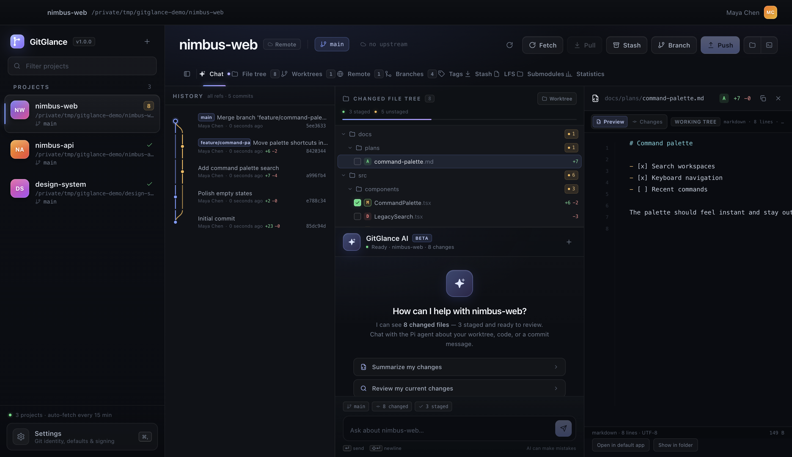
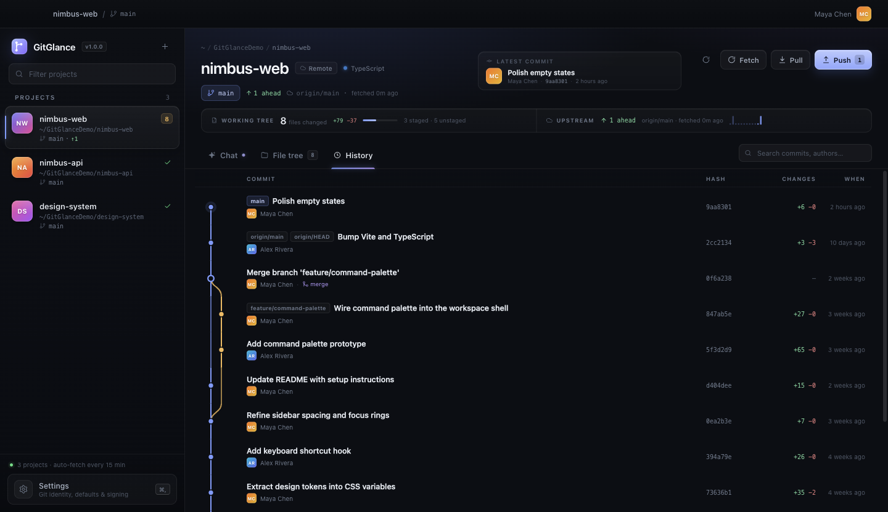

# GitGlance

A local Git desktop client built around the UI in [index.html](./index.html). It runs in Electron, executes the installed Git CLI, talks to the Pi coding agent for AI chat, and previews images, PDFs, Word/Excel/PowerPoint documents, and text files without uploading them anywhere.



## Documentation

The [usage guide](./docs/USAGE.md) is the end-user walkthrough: opening and switching repositories, reading the summary, browsing the working tree, previewing files, staging and committing, history, syncing with remotes, AI chat, settings, and troubleshooting.

Quick links:

- [Quick start](./docs/USAGE.md#quick-start)
- [Opening repositories](./docs/USAGE.md#opening-repositories)
- [Browsing files and changes](./docs/USAGE.md#browsing-files-and-changes)
- [Previewing files](./docs/USAGE.md#previewing-files)
- [Committing changes](./docs/USAGE.md#committing-changes)
- [History](./docs/USAGE.md#history)
- [AI chat with Pi](./docs/USAGE.md#ai-chat-with-pi)
- [Settings](./docs/USAGE.md#settings)
- [Keyboard shortcuts](./docs/USAGE.md#keyboard-shortcuts)
- [Troubleshooting](./docs/USAGE.md#troubleshooting)

### Screenshots

| File tree and preview | History |
| --- | --- |
|  |  |

| Working tree diff | Settings |
| --- | --- |
|  |  |

## Features

- **Multi-repository sidebar** with filtering, per-project branch and change counts, and an onboarding screen when no repository is open yet.
- **Repository summary** with the current branch, latest commit, working-tree state, upstream, ahead/behind counts, and Fetch / Pull / Push actions.
- **Full working-tree file tree**, including folders, symlinks, staged/unstaged/deleted badges, per-file stage toggles, and a filter.
- **Preview and diff pane** shared by the File Tree and Chat tabs. Select a file to preview it; switch to its staged or unstaged diff.
- **Rich previews**
  - Images: PNG, JPEG, GIF, WebP, AVIF, BMP, ICO, SVG.
  - PDF: rendered with PDF.js, with page navigation and zoom.
  - Word, Excel, PowerPoint, and OpenDocument files: converted to PDF with LibreOffice, then rendered with PDF.js.
  - Text and source files: encoding detection (UTF-8/UTF-16 and legacy encodings), syntax highlighting, line numbers, and truncation for very large files.
  - Deleted files: preview from the HEAD revision.
  - Binary files: a clear fallback instead of garbled content.
- **History tab** with a commit graph, refs, authors, stats, timestamps, and copyable hashes.
- **AI Chat tab** backed by the Pi agent, with streaming responses, tool activity (including Git and shell commands), stop/new-chat controls, per-repository conversations, and a changed-files sidebar that shares the preview pane.
- **Git settings** for identity, default branch, editor, pull strategy, GPG signing, pruning, and app-level auto-fetch behavior.
- **Appearance** with light, dark, and system-following themes, applied live and remembered between launches.
- **Language** with English and Simplified Chinese, applied live to the UI and native menus; repository content, code, and commit messages stay as-is.
- **Native desktop shell** with a custom protocol, sandboxed renderer, context-isolated IPC, native menus, and single-instance behavior.

## Requirements

- **Node.js 22+** and npm (tested with Node 26) to run from source or build the installer. The packaged app does not require Node.js.
- **macOS** to build the `.app`/DMG with electron-builder.
- **Git** installed and configured with your credentials. GitGlance uses the `git` on `PATH`; it does not bundle Git.
- **Pi agent CLI** (`pi`) available on `PATH`, or set `PI_BIN` to its executable. Configure the model endpoint in **Settings → LLM provider**; GitGlance starts Pi with `--mode rpc` and enables the `read`, `grep`, `find`, `ls`, and `bash` tools.
- **LibreOffice** is optional. Install it only if you want Word/Excel/PowerPoint previews. GitGlance looks for `soffice` in common locations or uses `LIBREOFFICE_BIN`.

The application source is strict TypeScript: the renderer is compiled by Vite, and the Electron main/preload/services are compiled with `tsc` into `dist-electron/`. Build and test scripts remain `.mjs` tooling.

Tested on macOS. The Electron main process is cross-platform, but the Office lookup and window chrome are tuned for macOS/Linux desktops.

## Run it

```bash
npm install
npm start
```

`npm start` builds the TypeScript renderer and Electron process, then launches Electron. On first launch, use **Open Repository…** (or <kbd>⌘O</kbd>) to add a Git working tree. Repositories are remembered between launches.

For renderer hot reload:

```bash
npm run dev
```

This starts Vite on `127.0.0.1:5173` and launches Electron against it.

To open a repository directly from the command line:

```bash
npx electron . --repo /path/to/repository
```

Set `PI_BIN` or `LIBREOFFICE_BIN` before launching if either tool is not in a standard location:

```bash
PI_BIN=/opt/homebrew/bin/pi LIBREOFFICE_BIN=/Applications/LibreOffice.app/Contents/MacOS/soffice npm start
```

## Build a macOS installer

The macOS package is built with electron-builder into `release/`:

```bash
npm run pack:mac           # release/mac-arm64/GitGlance.app
npm run dist:mac           # Apple Silicon DMG, signs if a Developer ID is available
npm run dist:mac:unsigned  # force an unsigned local build
```

The DMG is written to:

```text
release/GitGlance-1.0.0-arm64.dmg
```

Open it and drag **GitGlance** to Applications. Locally built artifacts are not quarantined by macOS, so the unsigned build opens normally on the build machine. Moving an unsigned build to another Mac can trigger a Gatekeeper warning.

By default the installer targets Apple Silicon (`arm64`). To build a universal DMG, run:

```bash
npm run build
npx electron-builder --mac --universal
```

### Signing and notarization

For distribution outside your own Mac, use an Apple Developer ID Application certificate. electron-builder discovers an installed certificate automatically, or accepts it through `CSC_LINK`/`CSC_NAME`. With the certificate installed, build and notarize with:

```bash
export APPLE_ID="you@example.com"
export APPLE_APP_SPECIFIC_PASSWORD="abcd-efgh-ijkl-mnop"
export APPLE_TEAM_ID="ABCDE12345"

npm run build
npx electron-builder --mac --arm64 --config.mac.notarize=true
```

`@electron/notarize` also accepts an App Store Connect API key via `APPLE_API_KEY`, `APPLE_API_KEY_ID`, and `APPLE_API_ISSUER`. The hardened-runtime entitlements used for signing are in `build/entitlements.mac.plist`.

The packaged app does not bundle Git, Pi, or LibreOffice. It looks for Git on `PATH`, Pi in standard Homebrew/home locations, and LibreOffice in `/Applications` or Homebrew. `PI_BIN` and `LIBREOFFICE_BIN` work when launching from a terminal; for a Finder launch, custom tool paths should be symlinked into a standard location such as `/opt/homebrew/bin` or `/usr/local/bin`.

## AI chat

The Chat tab keeps one Pi RPC process per repository. Each prompt includes:

- repository path and current branch;
- upstream and ahead/behind state;
- changed files with status and line counts;
- the eight most recent commits;
- staged and unstaged diffs (clipped to about 22 KB each);
- the file selected in the changed-files sidebar, if any.

Pi is launched with the `read`, `grep`, `find`, `ls`, and `bash` tools. It can run Git and other shell commands when you ask it to, including creating commits; the system prompt tells it to explain the impact and ask before destructive operations. Shell commands run with the same OS privileges as GitGlance, so review what the agent proposes and treat repository content as untrusted input. Chat state is kept in the renderer per repository, and **New chat** resets the underlying Pi session. **Stop** aborts the current response.

GitGlance configures the model itself. **Settings → LLM provider** stores a provider ID, API protocol (`openai-completions`, `openai-responses`, `anthropic-messages`, `google-generative-ai`, or `google-vertex`), base URL, API key, and model ID in the app config. Before starting Pi, GitGlance writes those values into its own `pi-agent` directory (`models.json` and `settings.json`) and launches Pi with `PI_CODING_AGENT_DIR` pointed at it. The generated settings also set `defaultProjectTrust` to `never`, so neither the user-level `~/.pi` nor a repository-local `.pi` directory is read. Prompts and file excerpts may be sent to the configured model endpoint; Git operations and previews stay local.

## Git behavior

GitGlance runs `git` directly in the repository working directory with `LC_ALL=C` and `GIT_TERMINAL_PROMPT=0`:

- stage and unstage individual files, stage/unstage all files;
- commit the staged changes;
- fetch (optionally all remotes and with pruning), pull with merge/rebase/ff-only, and push;
- read diffs, status with rename and symlink information, history, remotes, and upstream tracking state.

Authentication is delegated to your existing Git credential helper or SSH agent. Because terminal prompts are disabled, an operation that needs interactive credentials fails visibly instead of hanging.

Branch display is read-only: there is no branch checkout/create UI, merge-conflict editor, rebase, or cherry-pick workflow yet.

## Settings and local data

The Settings modal writes these keys to your **global** Git config (`~/.gitconfig` by default):

| UI | Git key |
| --- | --- |
| Full name / Email | `user.name`, `user.email` |
| Default branch | `init.defaultBranch` |
| Editor | `core.editor` |
| Pull: Merge | clears `pull.rebase` and `pull.ff` |
| Pull: Rebase | `pull.rebase=true` |
| Pull: Fast-forward only | `pull.ff=only` |
| Sign commits with GPG | `commit.gpgsign`, `user.signingkey` |
| Prune stale remote branches | `fetch.prune` |
| Fetch every remote | app preference |
| Theme | app preference |
| Language | app preference |
| LLM provider (provider, API, base URL, key, model) | app preference |

Auto-fetch interval, fetch-all behavior, theme, language, and the LLM provider are app preferences, not Git config. They are stored with the repository list in Electron's user data directory:

- macOS: `~/Library/Application Support/GitGlance/config.json`
- Windows: `%APPDATA%/GitGlance/config.json`
- Linux: `~/.config/GitGlance/config.json`

The LLM provider is written to a `pi-agent` directory next to that config (`config.json` holds the editable values; `models.json` and `settings.json` are generated for Pi and kept `0600`). Office conversion PDFs are cached in a `preview-cache` directory next to that config. The app keeps the 220 most recent conversions.

## Architecture

```text
electron/
  main.cts            Electron window, app:// protocol, native menu, IPC, Pi prompt context
  preload.cts         contextBridge API exposed as window.gitglance
  shared/
    models.ts         Git, preview, Pi, settings, and IPC payload types
    ipc.ts            Typed preload API surface and response envelopes
  lib/
    git.cts           Git CLI: status, tree, history, diffs, stage/commit, sync, global config
    preview.cts       Text/image/PDF/Office previews, encoding detection, LibreOffice cache
    pi.cts            Pi RPC subprocess, app-managed LLM provider config, streaming, abort/reset
    config.cts        Persistent repo list and app preferences
src/
  main.ts             Renderer state, tabs, tree, history, chat, settings, preview detail
  i18n.ts             English/Simplified Chinese interface dictionary and DOM translator
  preview.ts          PDF.js/image/text/binary preview mounting and teardown
  types.ts            Renderer state and tree/graph interfaces
  gitglance.d.ts      window.gitglance API declaration
  app.css             Electron chrome and application styles
public/
  theme-boot.js       Pre-paint theme and language selection
  pdfjs/              PDF.js worker, cmaps, standard fonts, and wasm assets
build/
  icon.svg            macOS icon source derived from the GitGlance mark
  icon.icns           compiled application and DMG icon
  entitlements.mac.plist
scripts/
  dev.mjs             Vite + Electron development launcher
  smoke.mjs           Isolated end-to-end smoke test against the built app
docs/
  USAGE.md            End-user usage guide with screenshots
  screenshots/        Documentation screenshots
release/              generated .app and DMG artifacts (gitignored)
```

The renderer is a plain ES-module browser app: no Node integration, no remote module, sandboxed preload, and all privileged work behind validated IPC handlers. File paths are validated against the repository root before reads or Git operations. External links open in the system browser.

## Verification

```bash
npm run typecheck
npm run smoke
```

`npm run typecheck` runs the strict renderer and Electron TypeScript projects. The smoke test builds both, creates a temporary Git repository and Electron profile, launches GitGlance, and checks that the project list, README preview, history, and Chat/History tabs render. It does not touch your real configuration or repositories.

To inspect the packaged rather than source app:

```bash
npm run pack:mac
open release/mac-arm64/GitGlance.app
```

Useful development variables:

| Variable | Purpose |
| --- | --- |
| `PI_BIN` | Path to the Pi executable (model settings come from the app's LLM provider config) |
| `LIBREOFFICE_BIN` | Path to `soffice` |
| `GITGLANCE_USER_DATA` | Override Electron user data (isolated profiles) |
| `GITGLANCE_REPO` | Open a repository on launch |
| `GITGLANCE_DISABLE_SINGLE_INSTANCE` | Allow parallel test instances |

## Limitations

- No interactive credential prompting, branch checkout/creation, merge tool, or conflict resolution UI.
- Office previews depend on LibreOffice and may not perfectly reproduce complex layouts.
- Text previews are capped at 4 MB; very large PDFs, images, and Office files are rejected with a clear message.
- The default local installer is unsigned and not notarized. Distributing it to other Macs requires a Developer ID certificate and notarization.
- The default DMG is arm64-only; Intel and universal builds need an explicit electron-builder architecture.
- AI chat requires a working Pi installation and an LLM provider configured in Settings. The rest of the app works without Pi.
- The AI agent can run shell commands with your user privileges. GitGlance does not sandbox those commands; review destructive or credentialed operations before proceeding.

The self-contained design mockup at [design/mockup.html](./design/mockup.html) mirrors the shipped UI's light/dark/system appearance and English/简体中文 language settings.
