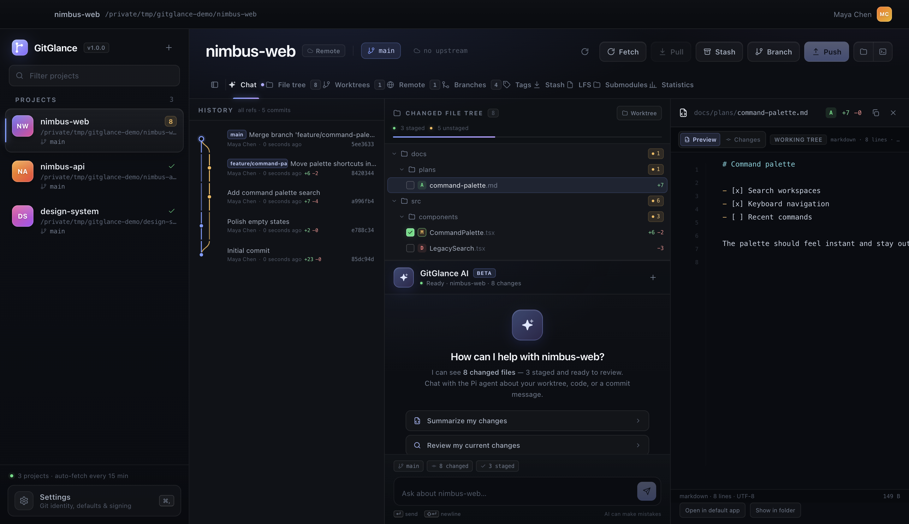
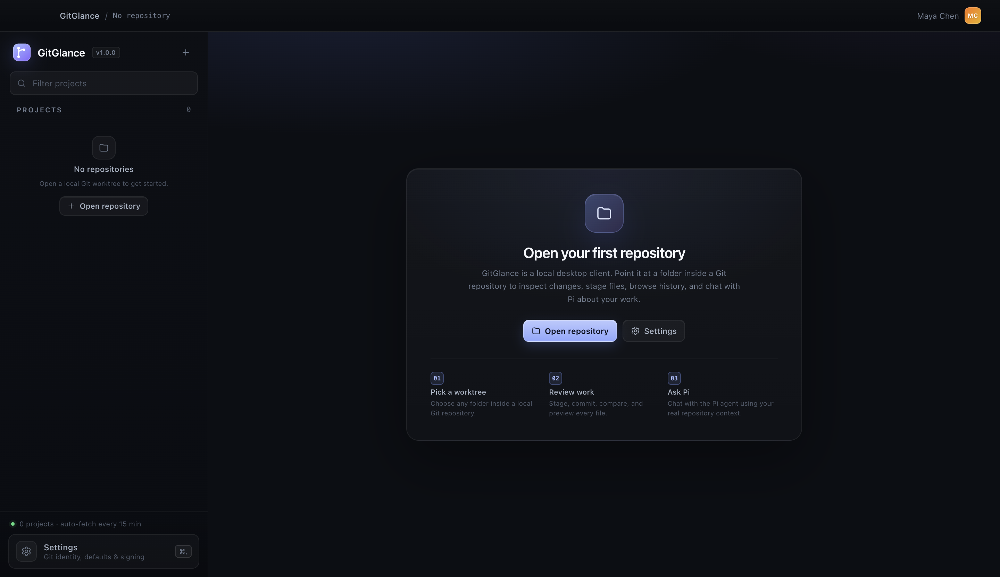
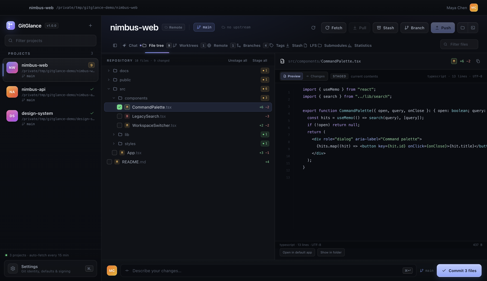
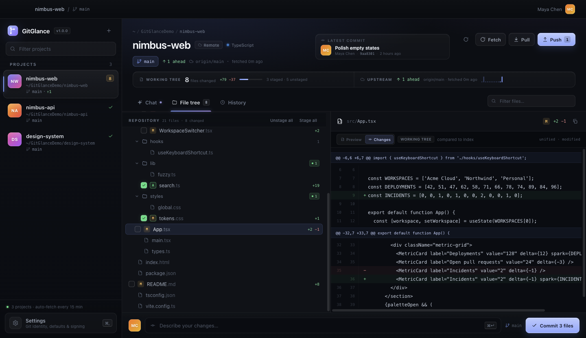
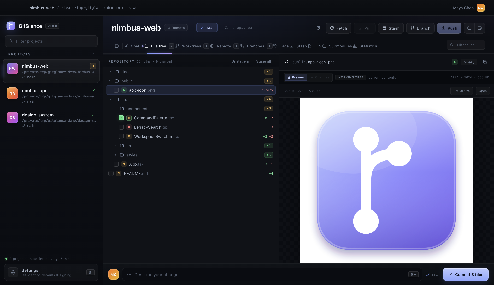
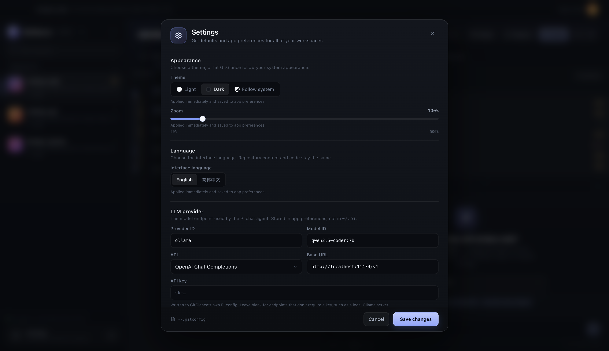
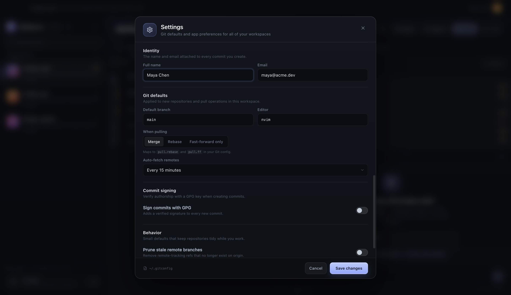
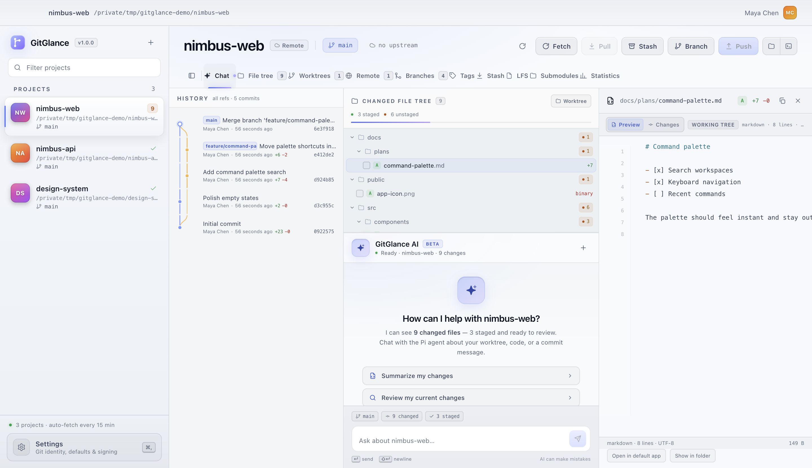
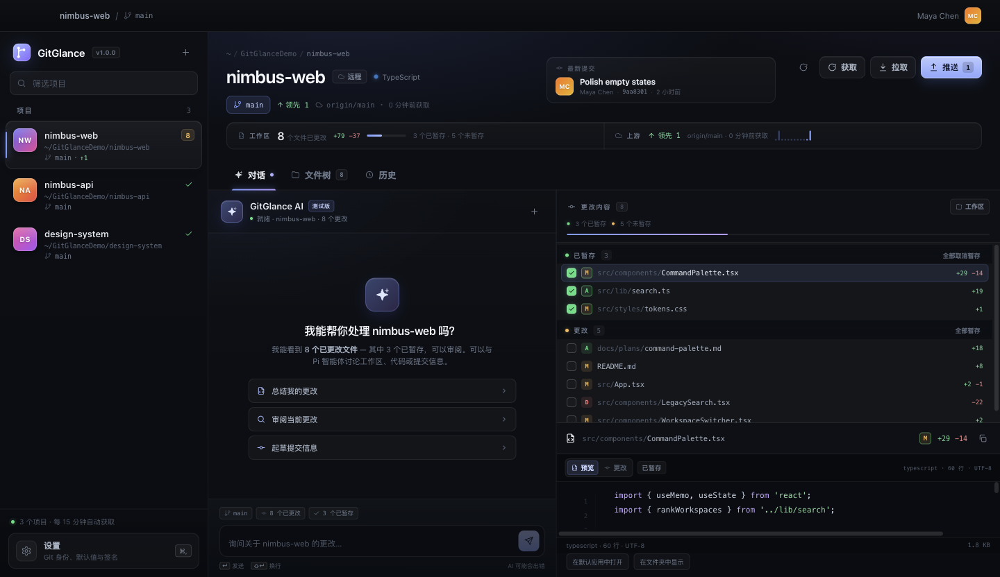

# GitGlance Usage Guide

GitGlance is a local-first Git desktop client. It runs on Electron, drives the
Git CLI you already have installed, previews files without uploading them, and
optionally connects to the [Pi](https://github.com/badlogic/pi-mono) coding
agent for chat about your working tree.

This guide walks through the everyday workflow: opening repositories, reading
changes, staging and committing, the Chat history graph and its commit
actions, syncing with remotes, and talking to Pi about your code.



## Contents

- [Quick start](#quick-start)
- [Opening repositories](#opening-repositories)
- [The workspace](#the-workspace)
- [Browsing files and changes](#browsing-files-and-changes)
- [Previewing files](#previewing-files)
- [Committing changes](#committing-changes)
- [Worktrees](#worktrees)
- [Remotes](#remotes)
- [Branches](#branches)
- [Tags](#tags)
- [Stash](#stash)
- [LFS](#lfs)
- [Submodules](#submodules)
- [Statistics](#statistics)
- [Syncing with remotes](#syncing-with-remotes)
- [AI chat with Pi](#ai-chat-with-pi)
- [Chat commit actions](#commit-actions)
- [Settings](#settings)
- [Appearance and language](#appearance-and-language)
- [Keyboard shortcuts](#keyboard-shortcuts)
- [Where your data lives](#where-your-data-lives)
- [Troubleshooting](#troubleshooting)
- [Limitations](#limitations)
- [Development](#development)

## Quick start

1. **Install Git** and make sure your identity is configured:

   ```bash
   git config --global user.name "Your Name"
   git config --global user.email "you@example.com"
   ```

2. **Launch GitGlance** from a source checkout:

   ```bash
   npm install
   npm start
   ```

   Or open the packaged app from `release/mac-arm64/GitGlance.app` after
   building it with `npm run pack:mac`.

3. **Open a repository** with the **Open repository** button, the **+** in the
   sidebar, or <kbd>⌘O</kbd>. Pick any folder inside a Git working tree;
   GitGlance resolves the repository root.

4. **Review and commit.** The File tree tab lists every file in the repository.
   Changed files carry status badges and +/− counts. Stage what you want, type
   a message, and press <kbd>⌘↵</kbd>.

5. **Optional: configure AI chat.** Open **Settings → LLM provider**, enter the
   provider, API, base URL, API key, and model, then save. The Chat tab uses the
   Pi agent with file tools and shell access, so it can also run Git commands
   when you ask it to.

On first launch, before any repository is added, GitGlance shows an onboarding
screen with shortcuts to open a repository or settings:



## Opening repositories

GitGlance remembers the repositories you add and restores the last active one
on the next launch.

| Action | How |
| --- | --- |
| Add a repository | **+** next to the GitGlance brand, **Open repository**, or <kbd>⌘O</kbd> |
| Switch repository | Click a project in the sidebar |
| Filter repositories | Type in **Filter projects** above the list |
| Remove from the list | **File → Remove Current Repository…** (the folder itself is untouched) |
| Open from a terminal | `npx electron . --repo /path/to/repository` or `GITGLANCE_REPO=/path/to/repo npm start` |

Each sidebar entry shows the repository name, its path, the current branch, and
either a change count (`8`), a clean checkmark, or an alert icon if the
repository can no longer be read. Ahead/behind counts appear next to the
branch when an upstream is configured.

> **Tip:** A repository is a working tree, not a bare `.git` directory. Choose
> a folder inside the checkout; GitGlance finds the root for you.

## The workspace

The window is split into three persistent regions:

- **Title bar** — the active repository and its local path, plus your Git
  identity chip on the right. Hovering the path reveals a copy button. Clicking
  the identity chip opens Settings.
- **Sidebar** — repositories, filtering, global sync status, and the Settings
  entry. The footer shows how many projects are open and the auto-fetch
  interval.
- **Main panel** — a summary header shared by all tabs, ten tabs, and the
  commit bar (File tree only).

### Summary header

The summary is the dashboard for the active repository:

- **Repository name** and a **Remote** or **Local** chip. The local path is in
  the title bar.
- **Branch, upstream, ahead/behind state**, and the last fetch time.
- **Fetch**, **Pull**, **Stash**, **Branch**, and **Push** actions. Fetch, Pull,
  and Push are disabled when there is no remote, no upstream, or nothing to
  push. Stash is disabled when the working tree is clean; Branch opens the
  branch picker described below.
- A two-button group at the far right: **Open folder** opens the repository’s
  local path in the system file manager, and **Open terminal** opens a terminal
  window already in that directory. On macOS the terminal is Terminal; on
  Windows, Command Prompt; on Linux, GitGlance uses the first available terminal
  emulator.

The tabs below are **Chat**, **File tree**, **Worktrees**, **Remote**,
**Branches**, **Tags**, **Stash**, **LFS**, **Submodules**, and **Statistics**.
Chat is the default tab; the File tree badge shows the number
of changed files, the Worktrees badge shows how many linked worktrees the
repository has, the Remote badge shows how many remotes are configured, the
Branches badge shows how many local and remote-tracking branches exist, the
Tags badge shows how many tags exist, the Stash badge shows how many stashes
are saved, the LFS badge shows how many LFS-tracked files exist, the Submodules
badge shows how many submodules are configured, and the Statistics badge shows
the commit count once the tab has loaded.

The **panel toggle** at the start of the tab bar hides the sidebar so the main
panel can use the full window width. Click it again to bring the project list
back.

## Browsing files and changes

Open the **File tree** tab to see the complete working tree, not just changed
files. Folders are collapsed by default; click a folder row to expand it. The
search field filters by path and expands matching folders automatically.

File rows use Git-style status badges:

| Badge | Meaning |
| --- | --- |
| `M` | Modified |
| `A` | Added or untracked |
| `D` | Deleted |
| `R` | Renamed |
| `U` | Conflicted |

The checkbox on the left stages or unstages that file. Staged rows are marked
with a filled check. The pane header offers **Stage all** / **Unstage all** for
bulk operations, and the commit bar at the bottom stages nothing implicitly.



Selecting a file opens it in the preview pane on the right. The pane header
shows the path, status, staged state, and +/− stats. Two view modes are
available:

- **Preview** — the file's current contents.
- **Changes** — the staged or unstaged diff, compared to HEAD or the index.

The mode chip tells you which side you are looking at: **Staged**, **Working
tree**, or **Clean**. Clean files still preview normally; they just have no
diff.



Deleted files preview from their **HEAD revision**, so you can inspect what was
removed before committing. Symlinks show their target instead of file contents.
Binary files show a clear fallback with an **Open** action rather than garbled
text.

## Previewing files

GitGlance chooses a previewer from the file type and size:

| File type | Preview |
| --- | --- |
| Text and source code | Syntax highlighting, line numbers, encoding detection, file info footer |
| Images (`png`, `jpg`, `jpeg`, `gif`, `webp`, `avif`, `bmp`, `ico`, `svg`) | Zoom-to-fit image with actual-size toggle, dimensions, and size |
| PDF | PDF.js rendering with page count, zoom in/out, and **Fit width** |
| Word, Excel, PowerPoint, OpenDocument | Converted to PDF with LibreOffice, then rendered with PDF.js |
| Everything else | Binary fallback with **Open** and **Show in folder** |



Limits are enforced with a readable message instead of a hang:

- Text previews are capped at 4 MB; large files are truncated with a notice.
- Images over 50 MB, PDFs over 150 MB, and office documents over 100 MB are
  rejected.
- PDFs render up to 220 pages at a time.

Office previews require LibreOffice. GitGlance looks for `soffice` in common
locations; set `LIBREOFFICE_BIN` to the executable if yours lives elsewhere.
Converted PDFs are cached next to the app config, and only the 220 most recent
conversions are kept.

## Committing changes

1. Stage one or more files with the checkboxes in the File tree (or **Stage
   all**).
2. Type a message in **Describe your changes…** at the bottom.
3. Press <kbd>⌘↵</kbd> or click **Commit N files**.

The commit bar shows your avatar, the target branch, and a button that stays
disabled until at least one file is staged. Draft messages are kept per
repository, so switching projects does not lose what you typed. An empty
message or an empty staging area produces a warning instead of a commit.

GitGlance runs `git commit` with the staged index. It does not add files
implicitly, and it does not amend or sign unless you enabled signing in
Settings.

## Worktrees

The **Worktrees** tab lists every working tree linked to the repository, as
reported by `git worktree list`. Each row shows the worktree name and path, its
checked-out branch (or `detached`), the short HEAD hash, and badges for:

- **current** — the worktree GitGlance has open;
- **main worktree** — the primary working tree that owns `.git`;
- **locked** — with the lock reason in the tooltip;
- **prunable** — with Git’s explanation in the tooltip;
- **bare** — for bare repositories.

The filter above the list searches names, paths, branches, and hashes. The
refresh button re-runs `git worktree list` without reloading the repository.

Each row has three actions:

| Action | Behavior |
| --- | --- |
| **Open** | Adds the linked worktree to the sidebar and switches GitGlance to it. Disabled for the current, prunable, and bare worktrees. |
| **Reveal** | Shows the worktree folder in Finder. |
| **Copy** | Copies the worktree path to the clipboard. |

Creating, moving, locking, and pruning worktrees remain terminal operations.
GitGlance only lists and opens existing worktrees.

## Remotes

The **Remote** tab lists every remote configured for the active repository,
read from `git remote -v` and `refs/remotes`:

- the remote name and its default branch, when `refs/remotes/<remote>/HEAD` is
  set;
- the fetch URL, plus the push URL when it differs;
- the number of remote-tracking branches, with the branch names shown as
  chips (up to eight, then a `+N` chip);
- a **Fetch** action per remote, which runs `git fetch <remote> --prune` using
  your pruning setting and refreshes ahead/behind counts;
- copy and open actions for the remote URL. **Open** is shown only for
  `http(s)` URLs; SSH remotes can be copied instead.

The filter above the list searches remote names, URLs, and tracking branch
names. The refresh button re-reads the remote configuration without reloading
the repository.

Adding, renaming, and removing remotes remain terminal operations. Use
`git remote add`, `git remote rename`, and `git remote remove`; GitGlance
picks up the change on refresh.

## Branches

The **Branches** tab lists local branches and remote-tracking branches, read
from `refs/heads` and `refs/remotes`. Each row shows:

- the branch name, with **current** and **remote** badges;
- the upstream branch and ahead/behind counts, or **up to date** when they
  match;
- a **gone** badge when the configured upstream no longer exists;
- the latest commit subject, author, relative time, and short hash.

Branches are ordered with the current branch first, then local branches by
latest commit, then remote-tracking branches. The filter searches branch names,
upstreams, authors, and commit subjects. The refresh button re-reads refs
without reloading the repository.

Each row has two actions:

| Action | Behavior |
| --- | --- |
| **Checkout** | Runs `git switch` for a local branch. For a remote-tracking branch, switches to the matching local branch or creates it with `--track`. Disabled for the current branch. |
| **Copy** | Copies the branch name to the clipboard. |

The **Branch** button in the summary header opens the branch picker without
leaving the current tab. It lists local and remote-tracking branches with the
same current, remote, and gone badges. Pick any row as the starting point, then
enter a name under **New branch from** and choose **Create & switch**; this runs
`git switch -c <name> <base>`. Starting from a remote-tracking branch also sets
up upstream tracking. Each row has a **Switch** action: remote-only branches are
checked out as a new local tracking branch. Press `Esc` to close the picker.

Checkout is refused by Git when uncommitted changes would be overwritten; the
error appears as a toast. Renaming and deleting branches remain terminal
operations (`git branch -m`, `git branch -d`).

## Tags

The **Tags** tab lists every tag in `refs/tags`, newest first. Each row shows:

- the tag name and a **lightweight** or **annotated** badge;
- a **HEAD** badge when the tag points at the current commit;
- the target commit subject, author, relative time, and short hash;
- for annotated tags, the annotation subject plus the tagger and tag date.

The filter searches tag names, commit subjects, authors, annotations, and
taggers. The refresh button re-reads tags without reloading the repository.

Each row has two actions:

| Action | Behavior |
| --- | --- |
| **Checkout** | Runs `git switch --detach` at the tag’s commit, leaving the repository in detached HEAD state. Disabled when the tag does not point to a commit. |
| **Copy** | Copies the tag name to the clipboard. |

Checkout is refused by Git when uncommitted changes would be overwritten; the
error appears as a toast. Creating, signing, and deleting tags remain terminal
operations (`git tag`, `git tag -d`).

## Stash

The **Stash** button in the summary header runs `git stash push
--include-untracked`, saving tracked and untracked changes in one step; it is
disabled when the working tree is clean. The stash appears in the tab below and
can be restored with Apply or Pop.

The **Stash** tab lists entries from `git stash list`, newest first. Each row
shows:

- the `stash@{N}` reference, source branch, and relative time;
- the stash message (`WIP on …` or the custom `On branch: …` message);
- the base commit short hash and subject;
- changed-file stats (`+N −M` and file count, or `binary`).

The filter searches references, commit hashes, branches, stash messages, and
base commit subjects. The refresh button re-reads the stash list without
reloading the repository.

Each row has four actions:

| Action | Behavior |
| --- | --- |
| **Apply** | Runs `git stash apply`, restoring the changes but keeping the stash. |
| **Pop** | Runs `git stash pop`, restoring the changes and dropping the stash on success. |
| **Drop** | Runs `git stash drop` after a confirmation; this cannot be undone. |
| **Copy** | Copies the `stash@{N}` reference to the clipboard. Click the short hash to copy the stash commit instead. |

Apply and pop are refused by Git when uncommitted changes would be
overwritten; the error appears as a toast. Creating stashes remains a terminal
operation (`git stash push`); GitGlance picks up new stashes on refresh.

## LFS

The **LFS** tab is a two-column audit of large files:

- **LFS files** lists tracked files matched by `filter=lfs` in
  `.gitattributes`, including files reported by `git lfs ls-files`. Each row
  shows the path, LFS object size, short OID, a **pointer** badge when the
  working-tree file is still an LFS pointer, and a **missing** badge when the
  working-tree file is gone.
- **Large files** lists tracked and untracked (but not ignored) files larger
  than 5 MB that are **not** LFS-tracked. Each row shows the path, size, a
  **tracked** or **untracked** badge, and the last-modified time.

Both columns have independent scroll areas. The filter above the columns
searches both paths. Each row has open, reveal-in-Finder, and copy-path
actions; missing LFS files disable open and reveal.

Git LFS detection falls back to `.gitattributes` and pointer parsing when the
`git lfs` command is unavailable. Tracking files with LFS remains a terminal
operation (`git lfs track`); GitGlance picks up the change on refresh.

## Submodules

The **Submodules** tab lists every entry from `git submodule status` with its
configuration from `.gitmodules`:

- the submodule path, **up to date** / **modified** / **uninitialized** /
  **conflicted** status, and a **dirty** badge when its working tree has local
  changes;
- the configured or checked-out branch, remote URL, and expected (`index`) and
  checked-out (`head`) commit hashes;
- the checked-out commit subject, author, and relative time, or
  **Not initialized**.

The filter searches paths, URLs, branches, statuses, and commit details. Each
row has four actions:

| Action | Behavior |
| --- | --- |
| **Update** | Runs `git submodule update --init -- <path>`, cloning uninitialized submodules or checking out the recorded commit. |
| **Open** | Adds the initialized submodule to the sidebar and switches GitGlance to it. Disabled when the submodule is not initialized. |
| **Reveal** | Shows the submodule folder in Finder. Disabled when it does not exist yet. |
| **Copy** | Copies the submodule path to the clipboard. Click the short hash to copy the recorded commit instead. |

Adding, removing, and configuring submodules remain terminal operations
(`git submodule add`, `git submodule deinit`); GitGlance picks up changes on
refresh.

## Statistics

The **Statistics** tab aggregates repository metrics on demand:

- **Cards** for commits, contributors, tracked files, tracked size, branches,
  and tags;
- **Languages** by tracked bytes, with a merged bar per language;
- **Commit activity** for the last 12 weeks;
- **Repository** facts: branch, HEAD, upstream, ahead/behind, remotes,
  worktrees, submodules, stashes, branches, tags, first/last commit, object
  store size, and last fetch;
- **Working tree** summary: changed/staged/unstaged files and added/deleted
  lines;
- **Contributors** with commit counts.

The tab loads when opened. **Refresh** recomputes the statistics. **Download**
opens a save dialog and writes a self-contained HTML report containing the
same cards, language bars, activity chart, repository facts, working-tree
summary, and contributor table. The report is styled for print or sharing and
needs no external assets.

## Syncing with remotes

The summary actions map directly to Git commands run in the repository:

| Action | Behavior |
| --- | --- |
| **Fetch** | Fetches the upstream remote, or every remote when **Fetch every remote** is enabled |
| **Pull** | Pulls using the configured strategy: merge, rebase, or fast-forward only |
| **Push** | Pushes the current branch to its upstream; disabled when there is nothing ahead |

Ahead/behind counts refresh after fetch, pull, push, and window focus.
Auto-fetch can run every 5, 15, 30, or 60 minutes, or be turned off, in
**Settings → Git defaults**. The sidebar footer shows the current interval.

Authentication is delegated to your existing Git credential helper or SSH
agent. GitGlance sets `GIT_TERMINAL_PROMPT=0`, so an operation that needs an
interactive password fails visibly instead of hanging. Configure credentials in
your terminal first if a push or pull is rejected.

## AI chat with Pi

The **Chat** tab is a three-column workspace around the Pi agent. The left
column shows the commit history graph; the middle column has the changed-file
tree above the conversation; the right column is a preview of the selected
changed file (or its diff). The preview starts closed and opens when a file is
selected, keeping the tree and chat wide until you need it. It is optional:
every other feature works without Pi.


### Prerequisites

- The `pi` executable on `PATH`, or `PI_BIN` pointing at it.
- An LLM provider configured in **Settings → LLM provider**. GitGlance owns this
  configuration: it writes `models.json` and `settings.json` into its own
  `pi-agent` directory and launches Pi with `PI_CODING_AGENT_DIR` set, so your
  `~/.pi` and repository-local `.pi` directories are not read.
- `defaultProjectTrust` is forced to `never`.

The chat header reports **Ready**, **Pi not configured**, or **Pi offline**. An
unavailable Pi does not prevent Git operations or previews.

### What Pi can see

Each prompt includes:

- the repository path and current branch;
- upstream and ahead/behind state;
- changed files with status and line counts;
- the eight most recent commits;
- staged and unstaged diffs, clipped to roughly 22 KB each;
- the file selected in the changed-file tree, if any.

Pi is launched with the `read`, `grep`, `find`, `ls`, and `bash` tools. It can
run Git and other shell commands when you ask it to, including creating
commits. The system prompt tells it to explain the impact and ask before
destructive operations, but the shell runs with the same OS privileges as
GitGlance. Treat repository content as untrusted input and review commands that
discard changes, rewrite history, or use credentials.

### Working in the chat

- Type in the composer and press <kbd>Enter</kbd> to send; <kbd>⇧↵</kbd> inserts
  a newline.
- While a response streams, the send button becomes **Stop**.
- **New chat** (the **+** button) resets the Pi session for the current
  repository.
- Conversations are kept per repository for the current app session.
- The **Changed File Tree** above the composer groups staged and unstaged files
  into folders. Select a file to open it in the right-hand preview column; the
  **×** button in the preview header hides the column again. Click a folder to
  collapse or expand it. Inline code references to changed files are clickable.
- The left **History** column shows the commit graph across local branches,
  remote-tracking branches, and tags. Commit hashes are clickable to copy the
  full SHA.
- Use the welcome suggestions for a quick summary, review, or commit-message
  draft.

### Commit actions

Right-click any commit in the **History** column for a grouped menu:

| Action | Behavior |
| --- | --- |
| **New Branch** / **New Tag** | Create a local branch or lightweight tag at that commit; a modal asks for the name. The branch is not checked out. |
| **Cherry Pick Commit** | Apply the commit to the current branch with `git cherry-pick`. Merge commits use their first parent; commits already in the current branch report that they are already present. |
| **Revert Commit** | Create a revert commit with `git revert --no-edit`. Merge commits use their first parent. |
| **Reset <branch> to here** | Choose **Soft**, **Mixed**, or **Hard**. Hard reset discards uncommitted index and working-tree changes. |
| **Squash into parent** | Rewrite history with an interactive rebase to combine the commit into its parent. Disabled for the root commit; merge commits and commits outside the current branch are rejected. |
| **Copy Commit SHA** | Copy the full commit hash. |

The menu is grouped into Create, Apply, Rewrite, and Copy sections. Reset and
squash rewrite history. Cherry-pick, revert, and squash abort and restore the
previous state if Git reports a conflict, so resolve complex histories in a
terminal.

Prompts and file excerpts are sent to the model endpoint you configure. Git
operations and previews stay local.

## Settings

Open Settings with the sidebar entry, the identity chip, or <kbd>⌘,</kbd>.
Theme, language, and zoom changes apply immediately; **Save changes** writes
Git settings to your global config and persists app preferences.



| Section | What it controls | Stored in |
| --- | --- | --- |
| **Appearance** | Light, dark, or follow-system theme; interface zoom (50%–500%) | App preferences |
| **Language** | English or Simplified Chinese for the interface and native menus | App preferences |
| **LLM provider** | Provider ID, model ID, API protocol, base URL, API key | App preferences |
| **Identity** | `user.name` and `user.email` for commits | `~/.gitconfig` |
| **Git defaults** | `init.defaultBranch`, `core.editor`, pull strategy, auto-fetch interval | Git config / app preferences |
| **Commit signing** | `commit.gpgsign` and `user.signingkey` | `~/.gitconfig` |
| **Behavior** | `fetch.prune` and fetch-every-remote | Git config / app preferences |



Pull strategy mapping:

| Choice | Git config |
| --- | --- |
| Merge | Clears `pull.rebase` and `pull.ff` |
| Rebase | `pull.rebase=true` |
| Fast-forward only | `pull.ff=only` |

The footer shows the Git config file being edited (`~/.gitconfig` by default).
Set `GIT_CONFIG_GLOBAL` to use a different global config file.

## Appearance and language

The theme control offers **Light**, **Dark**, and **Follow system**. The choice
is applied before the first paint on the next launch, so there is no flash of
the wrong theme.

The **Zoom** slider scales the whole window from **50%** to **500%**. The
default is **100%**; changes apply as soon as the slider is released and are
saved to app preferences.



The interface language can be switched between **English** and **简体中文**.
Native menus and dialogs follow the same choice. Repository content, code,
commit messages, and file paths are never translated.



## Keyboard shortcuts

| Shortcut | Action |
| --- | --- |
| <kbd>⌘O</kbd> | Open a repository |
| <kbd>⌘,</kbd> | Open Settings |
| <kbd>⌘R</kbd> | Refresh the active repository |
| <kbd>⌘↵</kbd> | Commit staged files (File tree) or save Settings (modal) |
| <kbd>Enter</kbd> | Send a chat message |
| <kbd>⇧↵</kbd> | Newline in the chat composer |
| <kbd>Esc</kbd> | Close Settings |
| <kbd>⌘W</kbd> | Close the window |
| <kbd>⌘Q</kbd> | Quit GitGlance |
| <kbd>⌘+</kbd> / <kbd>⌘−</kbd> / <kbd>⌘0</kbd> | Zoom in / out / actual size |

Clicking a file row previews it; clicking a commit hash copies the SHA; the
copy buttons next to the repository path in the title bar and next to the file
path put the path on the clipboard.

## Where your data lives

GitGlance does not have a server. Everything except optional AI chat stays on
the machine.

| Data | Location |
| --- | --- |
| Git identity, pull strategy, signing, pruning | Global Git config (`~/.gitconfig` by default) |
| Repository list, theme, language, zoom, auto-fetch, LLM provider | `~/Library/Application Support/GitGlance/config.json` on macOS (mode `0600`) |
| Generated Pi configuration | `<user data>/pi-agent/{models.json,settings.json}` |
| Office conversion cache | `<user data>/preview-cache` |
| Chat history | Renderer memory, per repository, for the current session |

On Windows and Linux the user data directory follows Electron's conventions
(`%APPDATA%/GitGlance` and `~/.config/GitGlance`). The config file contains the
LLM API key, so it is written with owner-only permissions.

Environment variables:

| Variable | Purpose |
| --- | --- |
| `PI_BIN` | Path to the Pi executable |
| `LIBREOFFICE_BIN` | Path to `soffice` |
| `GITGLANCE_USER_DATA` | Use an isolated profile directory |
| `GITGLANCE_REPO` | Open a repository on launch |
| `GITGLANCE_DISABLE_SINGLE_INSTANCE` | Allow parallel test instances |
| `GIT_CONFIG_GLOBAL` | Use a different global Git config |

## Troubleshooting

- **“This repository could not be opened.”** The folder may not be inside a Git
  working tree, may have been moved or deleted, or the `git` command failed.
  Check that `git -C <path> status` works in a terminal, then use **Try again**.
- **A repository is missing from the sidebar.** Re-add it with <kbd>⌘O</kbd>.
  The repository list is app state; removing a project from GitGlance never
  deletes files.
- **Push or pull fails with an authentication error.** GitGlance disables
  interactive prompts. Configure a credential helper or SSH key in your
  terminal, then retry.
- **Chat says “Pi not configured” or “Pi offline.”** Install `pi` or set
  `PI_BIN`, then fill in **Settings → LLM provider**. The provider needs a
  provider ID, base URL, and model ID; an API key is optional for local
  endpoints.
- **Office documents do not preview.** Install LibreOffice, or set
  `LIBREOFFICE_BIN` to `soffice`. The first conversion is slower because
  LibreOffice starts in the background. Complex layouts may not match the
  original exactly.
- **A preview is refused as too large.** Text is capped at 4 MB, images at
  50 MB, PDFs at 150 MB, and office documents at 100 MB. Open the file in its
  default app instead.
- **macOS says the app is damaged or from an unidentified developer.** Local
  builds are ad-hoc signed, not notarized. On the build machine they open
  normally; on another Mac, the download is quarantined and Gatekeeper blocks
  it. Clear the flag to test:

  ```bash
  xattr -dr com.apple.quarantine /Applications/GitGlance.app
  ```

  For distribution, use a Developer ID–signed and notarized build. See the
  README for signing steps.
- **The window opens but the repository list is empty.** The app may be using a
  different profile. Check `GITGLANCE_USER_DATA` and the config path shown in
  Settings.

## Limitations

- No merge-conflict editor or general interactive-rebase UI. Cherry-pick,
  revert, reset, and squash are available from the Chat history menu; conflicting
  cherry-pick, revert, or squash operations abort so you can resolve them in a
  terminal.
- Staging is per file; there is no hunk-level staging.
- Interactive credential prompts are disabled by design.
- Office previews depend on LibreOffice and may not reproduce complex layouts.
- The default macOS build is unsigned, not notarized, and arm64-only.
- Windows x64 NSIS installers can be built from macOS; Windows runtime behavior
  has not been tested here. Linux is not packaged.
- AI chat requires Pi and a configured LLM provider. All other features work
  without them.

## Development

```bash
npm run dev                # Vite + Electron with hot reload
npm run typecheck          # Strict TypeScript for renderer and Electron
npm run smoke              # Isolated end-to-end smoke test
npm run pack:mac           # release/mac-arm64/GitGlance.app
npm run dist:mac:unsigned  # macOS arm64 DMG
npm run dist:win           # Windows x64 installer
npm run dist:all           # both installers
```

See the [README](../README.md) for architecture, build, and signing details. On Apple Silicon, `dist:win` needs Rosetta 2 or a native `makensis` bundle as described there.
