# GitGlance 使用指南

[English](./USAGE.md) | **简体中文**

GitGlance 是一款本地优先的 Git 桌面客户端。它运行在 Electron 中，直接调用你已安装的 Git CLI，无需上传即可预览文件，并可选地连接 [Pi](https://github.com/badlogic/pi-mono) 编程智能体，围绕你的工作区展开对话。

本指南覆盖日常使用流程：打开仓库、阅读更改、暂存与提交、对话页的历史提交图及其提交操作、与远程同步，以及与 Pi 讨论你的代码。

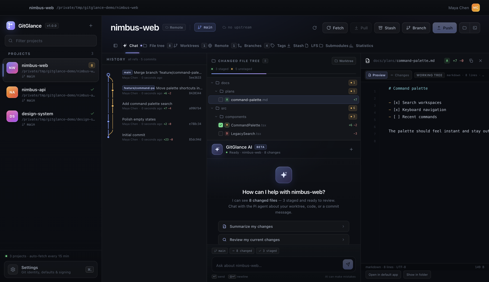

## 目录

- [快速开始](#快速开始)
- [打开仓库](#打开仓库)
- [工作区](#工作区)
- [浏览文件与更改](#浏览文件与更改)
- [预览文件](#预览文件)
- [提交更改](#提交更改)
- [工作树](#工作树)
- [远程](#远程)
- [分支](#分支)
- [标签](#标签)
- [贮藏](#贮藏)
- [LFS](#lfs)
- [子模块](#子模块)
- [统计](#统计)
- [与远程同步](#与远程同步)
- [与 Pi 进行 AI 对话](#与-pi-进行-ai-对话)
- [对话内的提交操作](#对话内的提交操作)
- [设置](#设置)
- [关于 GitGlance](#关于-gitglance)
- [外观与语言](#外观与语言)
- [键盘快捷键](#键盘快捷键)
- [你的数据保存在哪里](#你的数据保存在哪里)
- [故障排查](#故障排查)
- [限制](#限制)
- [开发](#开发)

## 快速开始

1. **安装 Git**，并确认已配置你的身份：

   ```bash
   git config --global user.name "Your Name"
   git config --global user.email "you@example.com"
   ```

2. **启动 GitGlance**（从源码检出运行）：

   ```bash
   npm install
   npm start
   ```

   也可以用 `npm run pack:mac` 构建后，从 `release/mac-arm64/GitGlance.app` 打开打包版应用。

3. **打开仓库**：使用 **打开仓库** 按钮、侧边栏中的 **+**，或 <kbd>⌘O</kbd>。选择 Git 工作区内的任意文件夹即可；GitGlance 会解析出仓库根目录。

4. **审阅并提交。** **文件树** 标签页列出仓库中的每个文件。已更改的文件带有状态徽标和 +/− 行数。暂存需要的文件，输入提交信息，然后按 <kbd>⌘↵</kbd>。

5. **可选：配置 AI 对话。** 打开 **设置 → LLM 提供商**，填写提供商、API、基础 URL、API 密钥与模型，然后保存。对话标签页使用带文件工具和 shell 访问权限的 Pi 智能体，因此在你要求时它也能运行 Git 命令。

首次启动、尚未添加任何仓库时，GitGlance 会显示带有打开仓库与设置快捷入口的引导界面：

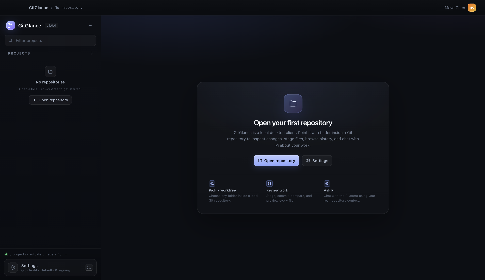

## 打开仓库

GitGlance 会记住你添加过的仓库，并在下次启动时恢复最后打开的仓库。

| 操作 | 方式 |
| --- | --- |
| 添加仓库 | GitGlance 标识旁的 **+**、**打开仓库**，或 <kbd>⌘O</kbd> |
| 切换仓库 | 单击侧边栏中的项目 |
| 筛选仓库 | 在列表上方的 **筛选项目** 中输入 |
| 从列表中移除 | **文件 → 移除当前仓库…**（文件夹本身不受影响） |
| 从终端打开 | `npx electron . --repo /path/to/repository` 或 `GITGLANCE_REPO=/path/to/repo npm start` |

每个侧边栏条目显示仓库名称、路径、当前分支，以及更改数量（`8`）、干净的勾选标记，或仓库无法再读取时的警告图标。配置了上游时，分支旁还会显示领先/落后数量。

> **提示：** 仓库指的是工作区，而不是裸的 `.git` 目录。选择检出目录内的任意文件夹即可；GitGlance 会为你找到根目录。

## 工作区

窗口分为三个常驻区域：

- **标题栏**——当前仓库及其本地路径，右侧是你的 Git 身份芯片。鼠标悬停在路径上会出现复制按钮。单击身份芯片会打开设置。
- **侧边栏**——仓库列表、筛选、全局同步状态和设置入口。底部显示已打开的项目数量与自动获取间隔。
- **主面板**——所有标签页共享的摘要栏、十个标签页，以及提交栏（仅文件树）。

### 摘要栏

摘要栏是当前仓库的仪表盘：

- **仓库名称**。本地路径显示在标题栏中。
- **分支、领先/落后状态**，以及上次获取时间。
- **获取**、**拉取**、**贮藏**、**分支** 和 **推送** 操作。没有远程、没有上游或没有可推送内容时，获取、拉取与推送会被禁用。工作区干净时贮藏会被禁用；分支会打开下文介绍的分支选择器。同步操作执行期间，对应按钮会显示旋转图标与 **正在获取…**/**正在拉取…**/**正在推送…** 标签，其他操作保持禁用；结束后会以成功或警告 toast 提示结果。
- 最右侧的两个按钮：**打开文件夹** 会在系统文件管理器中打开仓库的本地路径，**打开终端** 会在该目录中打开一个终端窗口。macOS 上使用「终端」；Windows 上使用命令提示符；Linux 上 GitGlance 会使用第一个可用的终端模拟器。

下方标签页依次为 **对话**、**文件树**、**工作树**、**远程**、**分支**、**标签**、**贮藏**、**LFS**、**子模块** 与 **统计**。对话是默认标签页；文件树徽标显示已更改文件数，工作树徽标显示仓库关联的工作树数量，远程徽标显示已配置的远程数，分支徽标显示本地与远程跟踪分支数，标签徽标显示标签数，贮藏徽标显示已保存的贮藏数，LFS 徽标显示 LFS 跟踪的文件数，子模块徽标显示已配置的子模块数，统计徽标在标签页加载后显示提交数。

仓库标题左侧的 **面板开关** 可以隐藏侧边栏，让主面板使用整个窗口宽度。再次单击即可恢复项目列表。

## 浏览文件与更改

打开 **文件树** 标签页可以看到完整的工作区，而不只是已更改的文件。文件夹默认折叠；单击文件夹行即可展开。搜索框按路径筛选，并自动展开匹配的文件夹。

文件行使用 Git 风格的状态徽标：

| 徽标 | 含义 |
| --- | --- |
| `M` | 已修改 |
| `A` | 已添加或未跟踪 |
| `D` | 已删除 |
| `R` | 已重命名 |
| `U` | 冲突 |

左侧的复选框用于暂存或取消暂存该文件。已暂存的行会显示实心勾选标记。面板标题栏提供 **全部暂存** / **全部取消暂存** 用于批量操作，底部的提交栏不会隐式暂存任何文件。

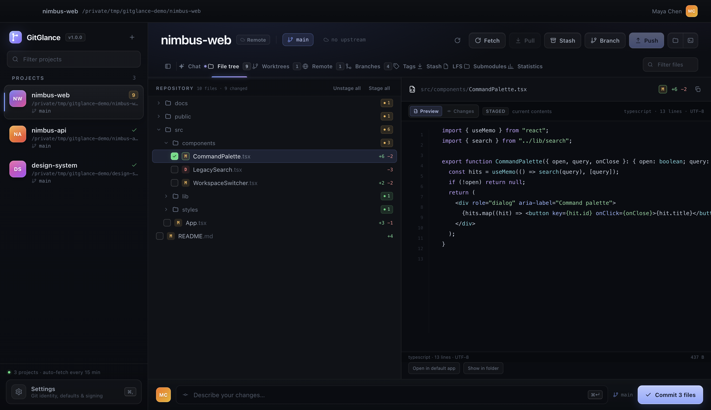

选中文件会在右侧预览面板中打开。面板标题栏显示路径、状态、暂存状态和 +/− 统计。提供两种视图模式：

- **预览**——文件当前的内容。
- **更改**——与 HEAD 或索引比较的已暂存或未暂存差异。

模式芯片会告诉你正在查看哪一侧：**已暂存**、**工作区** 或 **干净**。干净的文件仍可正常预览，只是没有差异。

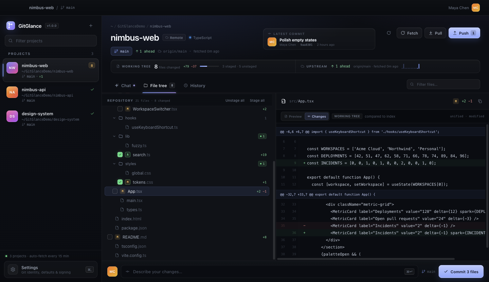

已删除文件会从其 **HEAD 版本** 预览，因此你可以在提交前查看被移除的内容。符号链接显示其目标而不是文件内容。二进制文件会显示清晰的回退提示并提供 **打开** 操作，而不是乱码。

## 预览文件

GitGlance 根据文件类型和大小选择合适的预览方式：

| 文件类型 | 预览 |
| --- | --- |
| 文本与源代码 | 语法高亮、行号、编码检测、文件信息页脚 |
| 图片（`png`、`jpg`、`jpeg`、`gif`、`webp`、`avif`、`bmp`、`ico`、`svg`） | 自适应缩放，可切换原始尺寸，显示尺寸与大小 |
| PDF | 由 PDF.js 渲染，显示页数，支持放大/缩小与 **适应宽度** |
| Word、Excel、PowerPoint、OpenDocument | 先用 LibreOffice 转换为 PDF，再由 PDF.js 渲染 |
| 其他所有类型 | 二进制回退提示，提供 **打开** 与 **在文件夹中显示** |

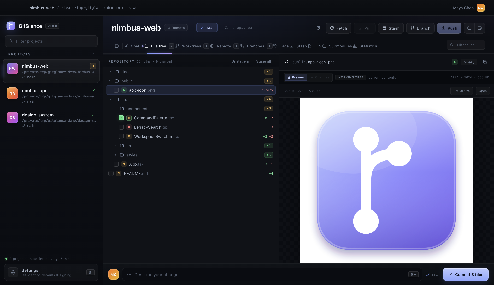

超出限制时会给出可读的提示，而不是卡住：

- 文本预览上限为 4 MB；过大的文件会被截断并给出提示。
- 超过 50 MB 的图片、超过 150 MB 的 PDF 和超过 100 MB 的 Office 文档会被拒绝。
- PDF 每次最多渲染 220 页。

Office 预览需要 LibreOffice。GitGlance 会在常见位置查找 `soffice`；如果它位于其他位置，请将 `LIBREOFFICE_BIN` 指向该可执行文件。转换后的 PDF 缓存在应用配置旁，最多保留最近 220 次转换。

## 提交更改

1. 在文件树中用复选框暂存一个或多个文件（或使用 **全部暂存**）。
2. 在底部的 **描述你的更改…** 中输入提交信息。
3. 按 <kbd>⌘↵</kbd> 或单击 **提交 N 个文件**。

提交栏显示你的头像、目标分支，以及一个在至少暂存一个文件之前保持禁用的按钮。草稿信息按仓库保留，因此切换项目不会丢失已输入的内容。信息为空或暂存区为空时会给出警告，而不是执行提交。

GitGlance 使用已暂存的索引运行 `git commit`。它不会隐式添加文件，也不会执行修补（amend）或签名，除非你在设置中启用了签名。

## 工作树

**工作树** 标签页列出与仓库关联的每个工作树，数据来自 `git worktree list`。每行显示工作树名称与路径、已检出的分支（或 `detached`）、短 HEAD 哈希，以及以下徽标：

- **当前**——GitGlance 正在打开的工作树；
- **主工作树**——拥有 `.git` 的主要工作区；
- **已锁定**——锁定原因显示在提示中；
- **可清理**——Git 的说明显示在提示中；
- **裸仓库**——该工作树本身是裸仓库。

列表上方的筛选器会搜索名称、路径、分支和哈希。刷新按钮会重新运行 `git worktree list`，而无需重新加载仓库。

每行有三个操作：

| 操作 | 行为 |
| --- | --- |
| **打开** | 将关联工作树添加到侧边栏，并将 GitGlance 切换到该工作树。对当前、可清理和裸工作树禁用。 |
| **在访达中显示** | 在访达中显示工作树文件夹。 |
| **复制** | 将工作树路径复制到剪贴板。 |

创建工作树、移动、锁定和清理仍需在终端中操作。GitGlance 只列出并打开已有的工作树。

## 远程

**远程** 标签页列出当前仓库配置的每个远程，数据来自 `git remote -v` 与 `refs/remotes`：

- 远程名称及其默认分支（当设置了 `refs/remotes/<remote>/HEAD` 时）；
- 获取 URL，以及推送 URL（两者不同时）；
- 远程跟踪分支的数量，分支名称以芯片形式显示（最多八个，之后显示 `+N` 芯片）；
- 每个远程的 **获取** 操作，按照你的清理设置运行 `git fetch <remote> --prune`，并刷新领先/落后数量；
- 远程 URL 的复制与打开操作。**打开** 仅对 `http(s)` URL 显示；SSH 远程可以复制。

列表上方的筛选器会搜索远程名称、URL 和跟踪分支名称。刷新按钮会重新读取远程配置，而无需重新加载仓库。

添加、重命名和移除远程仍需在终端中操作。使用 `git remote add`、`git remote rename` 和 `git remote remove`；GitGlance 会在刷新时获取更改。

## 分支

**分支** 标签页列出本地分支与远程跟踪分支，数据来自 `refs/heads` 与 `refs/remotes`。每行显示：

- 分支名称，以及 **当前** 和 **远程** 徽标；
- 上游分支与领先/落后数量，一致时显示 **已同步**；
- 配置的上游已不存在时显示 **已删除** 徽标；
- 最新提交的主题、作者、相对时间和短哈希。

分支排序为：当前分支优先，然后是本地分支（按最新提交），最后是远程跟踪分支。筛选器会搜索分支名称、上游、作者和提交主题。刷新按钮会重新读取引用，而无需重新加载仓库。

每行有两个操作：

| 操作 | 行为 |
| --- | --- |
| **切换** | 对本地分支运行 `git switch`。对远程跟踪分支，会切换到同名的本地分支，或用 `--track` 创建它。当前分支上会被禁用。 |
| **复制** | 将分支名称复制到剪贴板。 |

摘要栏中的 **分支** 按钮会打开分支选择器，而无需离开当前标签页。它列出本地与远程跟踪分支，并带有相同的当前、远程和已删除徽标。选择任意行作为起点，然后在 **新建分支基于** 下输入名称并选择 **创建并切换**；这会运行 `git switch -c <name> <base>`。从远程跟踪分支创建还会设置上游跟踪。每行都有 **切换** 操作：仅存在于远程的分支会作为新的本地跟踪分支检出。按 `Esc` 关闭选择器。

未提交的更改会被覆盖时，Git 会拒绝切换；错误会以 toast 提示显示。重命名和删除分支仍需在终端中操作（`git branch -m`、`git branch -d`）。

## 标签

**标签** 标签页列出 `refs/tags` 中的每个标签，最新的在前。每行显示：

- 标签名称，以及 **轻量** 或 **附注** 徽标；
- 标签指向当前提交时显示 **HEAD** 徽标；
- 目标提交的主题、作者、相对时间和短哈希；
- 附注标签还会显示附注主题、打标签者和打标签日期。

筛选器会搜索标签名称、提交主题、作者、附注和打标签者。刷新按钮会重新读取标签，而无需重新加载仓库。

每行有两个操作：

| 操作 | 行为 |
| --- | --- |
| **切换** | 在标签对应的提交上运行 `git switch --detach`，使仓库进入分离 HEAD 状态。标签未指向提交时会被禁用。 |
| **复制** | 将标签名称复制到剪贴板。 |

未提交的更改会被覆盖时，Git 会拒绝切换；错误会以 toast 提示显示。创建、签名和删除标签仍需在终端中操作（`git tag`、`git tag -d`）。

## 贮藏

摘要栏中的 **贮藏** 按钮运行 `git stash push --include-untracked`，一步保存已跟踪和未跟踪的更改；工作区干净时会被禁用。贮藏会出现在下方标签页中，可通过应用或弹出恢复。

**贮藏** 标签页列出 `git stash list` 中的条目，最新的在前。每行显示：

- `stash@{N}` 引用、来源分支和相对时间；
- 贮藏信息（`WIP on …` 或自定义的 `On branch: …` 信息）；
- 基础提交的短哈希与主题；
- 已更改文件统计（`+N −M` 与文件数，或 `binary`）。

筛选器会搜索引用、提交哈希、分支、贮藏信息和基础提交主题。刷新按钮会重新读取贮藏列表，而无需重新加载仓库。

每行有四个操作：

| 操作 | 行为 |
| --- | --- |
| **应用** | 运行 `git stash apply`，恢复更改但保留贮藏。 |
| **弹出** | 运行 `git stash pop`，恢复更改并在成功后删除贮藏。 |
| **删除** | 确认后运行 `git stash drop`；此操作无法撤销。 |
| **复制** | 将 `stash@{N}` 引用复制到剪贴板。单击短哈希可复制贮藏提交。 |

未提交的更改会被覆盖时，Git 会拒绝应用和弹出；错误会以 toast 提示显示。创建贮藏仍需在终端中操作（`git stash push`）；GitGlance 会在刷新时获取新的贮藏。

## LFS

**LFS** 标签页是对大文件的双栏审计：

- **LFS 文件** 列出 `.gitattributes` 中匹配 `filter=lfs` 的已跟踪文件，包括 `git lfs ls-files` 报告的文件。每行显示路径、LFS 对象大小、短 OID，工作区文件仍是 LFS 指针时显示 **指针** 徽标，工作区文件已不存在时显示 **缺失** 徽标。
- **大文件** 列出大于 5 MB 且 **未** 被 LFS 跟踪的已跟踪与未跟踪（但未被忽略）文件。每行显示路径、大小、**已跟踪** 或 **未跟踪** 徽标，以及最后修改时间。

两栏各有独立的滚动区域。栏上方的筛选器会同时搜索两侧的路径。每行都有打开、在访达中显示和复制路径操作；缺失的 LFS 文件会禁用打开与显示。

当 `git lfs` 命令不可用时，Git LFS 检测会回退到 `.gitattributes` 与指针解析。使用 LFS 跟踪文件仍需在终端中操作（`git lfs track`）；GitGlance 会在刷新时获取更改。

## 子模块

**子模块** 标签页列出 `git submodule status` 的每个条目及其在 `.gitmodules` 中的配置：

- 子模块路径、**已同步** / **已修改** / **未初始化** / **冲突** 状态，以及其工作区存在本地更改时的 **有改动** 徽标；
- 已配置或已检出的分支、远程 URL，以及期望（`index`）与已检出（`head`）的提交哈希；
- 已检出提交的主题、作者和相对时间，或 **未初始化**。

筛选器会搜索路径、URL、分支、状态和提交详情。每行有四个操作：

| 操作 | 行为 |
| --- | --- |
| **更新** | 运行 `git submodule update --init -- <path>`，克隆未初始化的子模块或检出记录的提交。 |
| **打开** | 将已初始化的子模块添加到侧边栏，并将 GitGlance 切换到该子模块。子模块未初始化时会被禁用。 |
| **在访达中显示** | 在访达中显示子模块文件夹。尚不存在时会被禁用。 |
| **复制** | 将子模块路径复制到剪贴板。单击短哈希可复制记录的提交。 |

添加、移除和配置子模块仍需在终端中操作（`git submodule add`、`git submodule deinit`）；GitGlance 会在刷新时获取更改。

## 统计

**统计** 标签页按需汇总仓库指标：

- **卡片**：提交、贡献者、已跟踪文件、已跟踪大小、分支和标签；
- **语言**：按已跟踪字节数统计，每种语言显示合并后的条形图；
- **提交活动**：最近 12 周；
- **仓库** 信息：分支、HEAD、上游、领先/落后、远程、工作树、子模块、贮藏、分支、标签、首次/最近提交、对象库大小和上次获取；
- **工作区** 摘要：已更改/已暂存/未暂存文件，以及新增/删除行数；
- **贡献者** 及其提交数。

打开标签页时即加载。**刷新** 会重新计算统计。**下载** 会打开保存对话框，写入一份自包含的 HTML 报告，包含相同的卡片、语言条形图、活动图表、仓库信息、工作区摘要和贡献者表格。报告适合打印或分享，无需任何外部资源。

## 与远程同步

摘要栏操作直接对应在仓库中运行的 Git 命令：

| 操作 | 行为 |
| --- | --- |
| **获取** | 获取上游远程，或启用 **获取所有远程** 时获取每个远程 |
| **拉取** | 按配置的策略拉取：合并、变基或仅快进 |
| **推送** | 将当前分支推送到其上游；没有领先提交时会被禁用 |

获取、拉取、推送以及窗口获得焦点后都会刷新领先/落后数量。自动获取可以在 **设置 → Git 默认值** 中设为每 5、15、30 或 60 分钟一次，也可以关闭。侧边栏底部显示当前间隔。

认证交由你现有的 Git 凭据助手或 SSH agent 处理。GitGlance 设置了 `GIT_TERMINAL_PROMPT=0`，因此需要交互式密码的操作会显式失败，而不是挂起。如果推送或拉取被拒绝，请先在终端中配置凭据。

## 与 Pi 进行 AI 对话

**对话** 标签页是围绕 Pi 智能体的三栏工作区。左栏显示提交历史图；中栏在对话上方显示已更改文件树；右栏是所选已更改文件的预览（或其差异）。预览默认关闭，选中文件时才打开，因此在需要之前文件树与对话始终保持较宽。它是可选的：其他所有功能无需 Pi 也能使用。


### 先决条件

- `pi` 可执行文件位于 `PATH` 中，或通过 `PI_BIN` 指向它。
- 在 **设置 → LLM 提供商** 中配置好 LLM 提供商。GitGlance 自行管理该配置：它把 `models.json` 与 `settings.json` 写入自有的 `pi-agent` 目录，并以 `PI_CODING_AGENT_DIR` 指向该目录来启动 Pi，因此不会读取你的 `~/.pi` 和仓库内的 `.pi` 目录。
- `defaultProjectTrust` 被强制设为 `never`。

对话标题栏会显示 **就绪**、**Pi 未配置** 或 **Pi 离线**。Pi 不可用不会影响 Git 操作或预览。

### Pi 能看到什么

每次提示包含：

- 仓库路径与当前分支；
- 上游及领先/落后状态；
- 已更改文件及其状态与行数；
- 最近八条提交；
- 已暂存与未暂存的差异，各截断到约 22 KB；
- 已更改文件树中选中的文件（若有）。

Pi 以 `read`、`grep`、`find`、`ls` 与 `bash` 工具启动。它可以按你的要求运行 Git 及其他 shell 命令，包括创建提交。系统提示词要求它说明影响，并在执行破坏性操作前征求确认，但 shell 以与 GitGlance 相同的操作系统权限运行。请将仓库内容视为不受信任的输入，并审阅会丢弃更改、重写历史或使用凭据的命令。

### 在对话中工作

- 在输入框中输入，按 <kbd>Enter</kbd> 发送；<kbd>⇧↵</kbd> 插入换行。
- 回复流式输出期间，发送按钮会变为 **停止**。
- **新建对话**（**+** 按钮）会重置当前仓库的 Pi 会话。
- 对话按仓库保留，仅在当前应用会话内有效。
- 输入框上方的 **更改文件树** 把已暂存与未暂存文件按文件夹分组。选中文件会在右侧预览栏中打开；预览标题栏中的 **×** 按钮会再次隐藏该栏。单击文件夹可折叠或展开。指向已更改文件的内联代码引用可单击。
- 左侧 **历史** 栏显示跨本地分支、远程跟踪分支和标签的提交图。提交哈希可单击复制完整 SHA。最先加载最新的 80 个提交；滚动到底部会加载更早的分页，副标题会显示已加载提交数占全引用总数的比例。贮藏不属于历史——请见 **贮藏** 标签页。
- 欢迎建议可用于快速总结、审阅或起草提交信息。
- 设置中的自定义 **提示词芯片** 会显示在输入框上方、已暂存标签旁。芯片上显示提示词的简短标题；单击芯片会用完整提示词填充输入框并发送。
- 光标位于输入框末尾时，<kbd>↑</kbd> 召回上一条已发送消息，<kbd>↓</kbd> 再向后移动。到达最早或最新一条时输入保持不变。

### 提示词

在 **设置 → 提示词** 中配置：

- **系统提示词**——追加到 GitGlance 内置助手提示词和 Pi 默认提示词之后的额外指令。保存会重启运行中的 Pi 会话，使下一条消息使用新的指令。
- **自定义用户提示词**——最多八条。每条含一个简短标题（显示在对话输入框上方、已暂存标签旁的芯片上）与完整发送文本；单击芯片会用完整提示词填充输入框并发送给 Pi。

提示词保存在应用偏好（`config.json`）中，而不是 `~/.pi`。

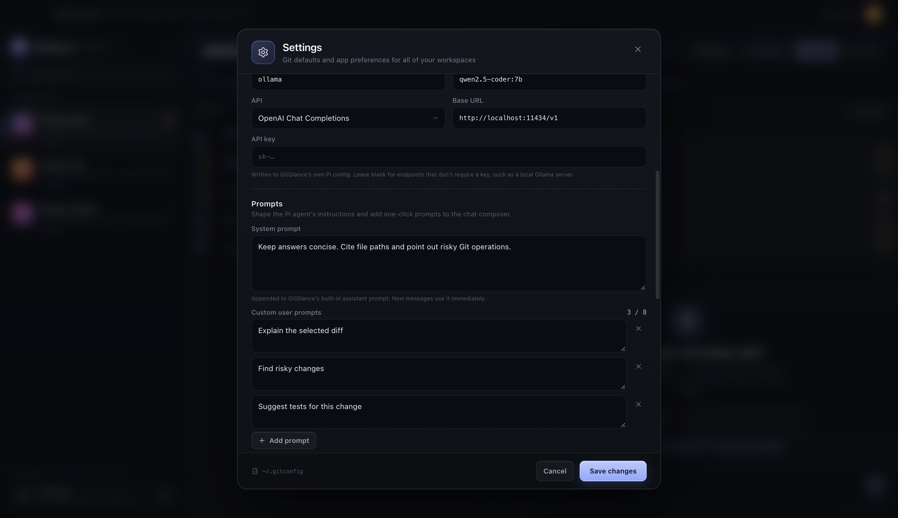

### 对话内的提交操作

在 **历史** 栏中右键单击任意提交会打开分组菜单：

| 操作 | 行为 |
| --- | --- |
| **新建分支** / **新建标签** | 在该提交上创建本地分支或轻量标签；会弹出模态框要求输入名称。分支不会被检出。 |
| **拣选提交** | 用 `git cherry-pick` 将提交应用到当前分支。合并提交使用其第一个父提交；已在当前分支中的提交会提示已存在。 |
| **还原提交** | 用 `git revert --no-edit` 创建还原提交。合并提交使用其第一个父提交。 |
| **将 <branch> 重置到此提交** | 选择 **软重置**、**混合重置** 或 **硬重置**。硬重置会丢弃未提交的索引与工作区更改。 |
| **压缩到父提交** | 通过交互式变基重写历史，把该提交合并进其父提交。根提交上会被禁用；合并提交和当前分支之外的提交会被拒绝。 |
| **复制提交 SHA** | 复制完整提交哈希。 |

菜单分为「创建」「应用」「重写」「复制」四组。重置和压缩会重写历史。拣选、还原和压缩在 Git 报告冲突时会中止并恢复之前的状态，因此复杂历史请在终端中解决。

提示词与文件片段会发送到你配置的模型端点。Git 操作与预览始终在本地完成。

## 设置

通过侧边栏入口、身份芯片或 <kbd>⌘,</kbd> 打开设置。主题、语言和缩放更改立即生效；**保存更改** 会将 Git 设置写入全局配置并持久化应用偏好。

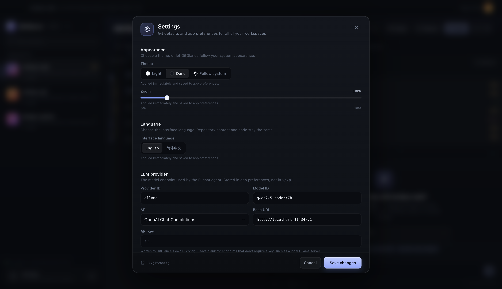

| 分区 | 控制内容 | 存储位置 |
| --- | --- | --- |
| **外观** | 浅色、深色或跟随系统主题；界面缩放（50%–300%） | 应用偏好 |
| **语言** | 界面与原生菜单的英文、简体中文或跟随系统 | 应用偏好 |
| **LLM 提供商** | 提供商 ID、模型 ID、API 协议、基础 URL、API 密钥 | 应用偏好 |
| **提示词** | 追加到内置指令之后的系统提示词；最多八条带标题的自定义用户提示词，以对话芯片形式显示 | 应用偏好 |
| **身份** | 提交使用的 `user.name` 与 `user.email` | `~/.gitconfig` |
| **Git 默认值** | `init.defaultBranch`、`core.editor`、拉取策略、自动获取间隔 | Git 配置 / 应用偏好 |
| **提交签名** | `commit.gpgsign` 与 `user.signingkey` | `~/.gitconfig` |
| **行为** | `fetch.prune` 与获取所有远程 | Git 配置 / 应用偏好 |

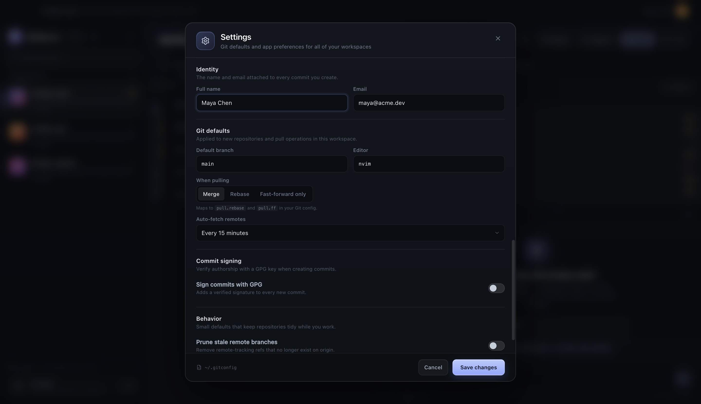

拉取策略映射：

| 选项 | Git 配置 |
| --- | --- |
| 合并 | 清除 `pull.rebase` 与 `pull.ff` |
| 变基 | `pull.rebase=true` |
| 仅快进 | `pull.ff=only` |

页脚显示正在编辑的 Git 配置文件（默认 `~/.gitconfig`）。设置 `GIT_CONFIG_GLOBAL` 可使用其他全局配置文件。

## 关于 GitGlance

侧边栏标识旁的信息按钮（发布标签旁）会打开关于对话框。它显示正在运行的发布标签——与安装包文件名相同的 `YYMMDD.shortSHA` 标记——以及 MIT 许可证、运行时技术栈、Pi 助手使用你所配置的模型端点的说明，还有仓库与发布下载链接。链接会在默认浏览器中打开；可通过 **×**、**关闭**、<kbd>Esc</kbd> 或单击对话框外部关闭。

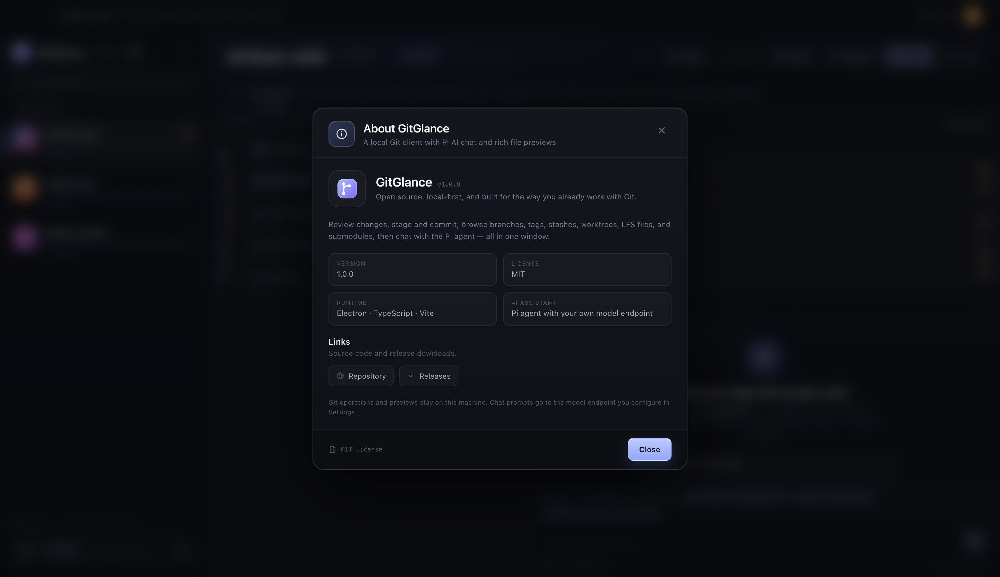

## 外观与语言

主题控件提供 **浅色**、**深色** 与 **跟随系统**。选择会在下次启动首帧渲染前应用，因此不会闪现错误的主题。

**缩放** 滑块会整体缩放窗口，范围从 **50%** 到 **300%**。默认是 **100%**；松开滑块即生效，并保存到应用偏好。

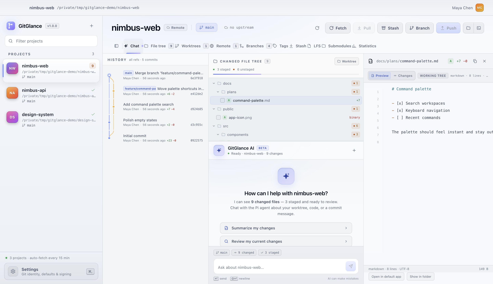

界面语言可在 **英文**、**简体中文** 与 **跟随系统** 之间切换。跟随系统会根据操作系统语言选择界面语言（中文系统使用简体中文，其他系统使用英文），并在每次启动时重新读取。原生菜单和对话框会遵循同样的选择。仓库内容、代码、提交信息和文件路径永远不会被翻译。

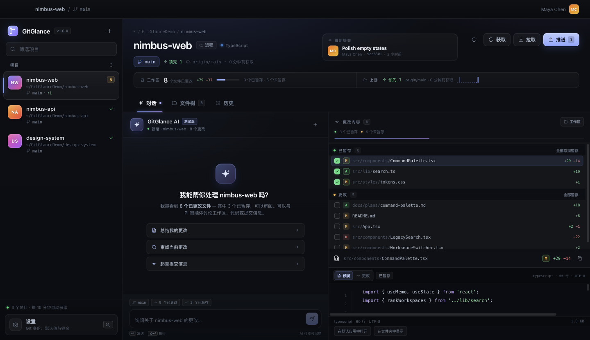

## 键盘快捷键

| 快捷键 | 操作 |
| --- | --- |
| <kbd>⌘O</kbd> | 打开仓库 |
| <kbd>⌘,</kbd> | 打开设置 |
| <kbd>⌘R</kbd> | 刷新当前仓库 |
| <kbd>⌘↵</kbd> | 提交已暂存文件（文件树）或保存设置（模态框） |
| <kbd>Enter</kbd> | 发送对话消息 |
| <kbd>⇧↵</kbd> | 在对话输入框中换行 |
| <kbd>↑</kbd> / <kbd>↓</kbd> | 光标位于对话输入框末尾时：召回上一条 / 下一条已发送消息 |
| <kbd>Esc</kbd> | 关闭打开的对话框或上下文菜单 |
| <kbd>⌘W</kbd> | 关闭窗口 |
| <kbd>⌘Q</kbd> | 退出 GitGlance |
| <kbd>⌘+</kbd> / <kbd>⌘−</kbd> / <kbd>⌘0</kbd> | 放大 / 缩小 / 原始大小 |

单击文件行即可预览；单击提交哈希会复制 SHA；标题栏中仓库路径旁的复制按钮和文件路径旁的复制按钮会把路径放入剪贴板。

## 你的数据保存在哪里

GitGlance 没有服务器。除可选的 AI 对话外，所有内容都留在本机。

| 数据 | 位置 |
| --- | --- |
| Git 身份、拉取策略、签名、清理 | 全局 Git 配置（默认 `~/.gitconfig`） |
| 仓库列表、主题、语言、缩放、自动获取、LLM 提供商、系统提示词与自定义提示词 | macOS 上为 `~/Library/Application Support/GitGlance/config.json`（权限 `0600`） |
| 生成的 Pi 配置 | `<user data>/pi-agent/{models.json,settings.json}` |
| Office 转换缓存 | `<user data>/preview-cache` |
| 对话历史 | 渲染进程内存，按仓库保留，仅在当前会话内有效 |

在 Windows 与 Linux 上，用户数据目录遵循 Electron 的约定（`%APPDATA%/GitGlance` 与 `~/.config/GitGlance`）。配置文件包含 LLM API 密钥，因此以仅所有者可读的权限写入。

环境变量：

| 变量 | 用途 |
| --- | --- |
| `PI_BIN` | Pi 可执行文件路径 |
| `LIBREOFFICE_BIN` | `soffice` 的路径 |
| `GITGLANCE_USER_DATA` | 使用隔离的配置目录 |
| `GITGLANCE_REPO` | 启动时打开某个仓库 |
| `GITGLANCE_DISABLE_SINGLE_INSTANCE` | 允许并行运行测试实例 |
| `GIT_CONFIG_GLOBAL` | 使用其他全局 Git 配置 |

## 故障排查

- **「无法打开此仓库。」** 文件夹可能不在 Git 工作区内，可能已被移动或删除，或者 `git` 命令执行失败。先在终端中确认 `git -C <path> status` 可以正常运行，然后使用 **重试**。
- **侧边栏中缺少某个仓库。** 用 <kbd>⌘O</kbd> 重新添加它。仓库列表属于应用状态；从 GitGlance 移除项目永远不会删除文件。
- **推送或拉取因认证错误而失败。** GitGlance 禁用了交互式提示。先在终端中配置凭据助手或 SSH 密钥，然后重试。
- **对话显示「Pi 未配置」或「Pi 离线」。** 安装 `pi` 或设置 `PI_BIN`，然后在 **设置 → LLM 提供商** 中填写配置。提供商需要提供商 ID、基础 URL 和模型 ID；本地端点可以省略 API 密钥。
- **Office 文档无法预览。** 安装 LibreOffice，或将 `LIBREOFFICE_BIN` 指向 `soffice`。首次转换会更慢，因为 LibreOffice 需要在后台启动。复杂版式可能无法与原文件完全一致。
- **预览因文件过大而被拒绝。** 文本上限为 4 MB，图片为 50 MB，PDF 为 150 MB，Office 文档为 100 MB。请改用默认应用打开该文件。
- **macOS 提示应用已损坏或来自未识别的开发者。** 本地构建只做了 ad-hoc 签名，未公证。在构建机上可以正常打开；复制到另一台 Mac 后，下载会被隔离，Gatekeeper 会阻止启动。清除隔离标记以便测试：

  ```bash
  xattr -dr com.apple.quarantine /Applications/GitGlance.app
  ```

  若要分发，请使用 Developer ID 签名并公证的构建。签名步骤见 [README](../README.md)。
- **窗口打开了，但仓库列表为空。** 应用可能在使用其他配置目录。检查 `GITGLANCE_USER_DATA` 以及设置中显示的配置路径。

## 限制

- 没有合并冲突编辑器或通用的交互式变基界面。拣选、还原、重置与压缩可从对话历史菜单使用；发生冲突的拣选、还原或压缩会中止，以便你在终端中解决。
- 暂存以文件为单位，没有块级（hunk）暂存。
- 按设计禁用了交互式凭据提示。
- Office 预览依赖 LibreOffice，可能无法完全还原复杂版式。
- 默认的 macOS 构建未签名、未公证，且仅支持 arm64。
- Windows x64 NSIS 安装包可从 macOS 构建；本工作区尚未在 Windows 上验证运行时行为。Linux 未打包。
- AI 对话需要 Pi 和已配置的 LLM 提供商。其他所有功能无需它们即可使用。

## 开发

```bash
npm run dev                # Vite + Electron，热重载
npm run typecheck          # 渲染进程与 Electron 的严格 TypeScript 检查
npm run smoke              # 隔离式端到端冒烟测试
npm run pack:mac           # release/mac-arm64/GitGlance.app
npm run dist:mac:unsigned  # macOS arm64 DMG
npm run dist:win           # Windows x64 安装包
npm run dist:all           # 两个安装包
```

架构、构建与签名细节见 [README](../README.md)。在 Apple Silicon 上，`dist:win` 需要 Rosetta 2 或原生的 `makensis` 包，具体见该文档。
